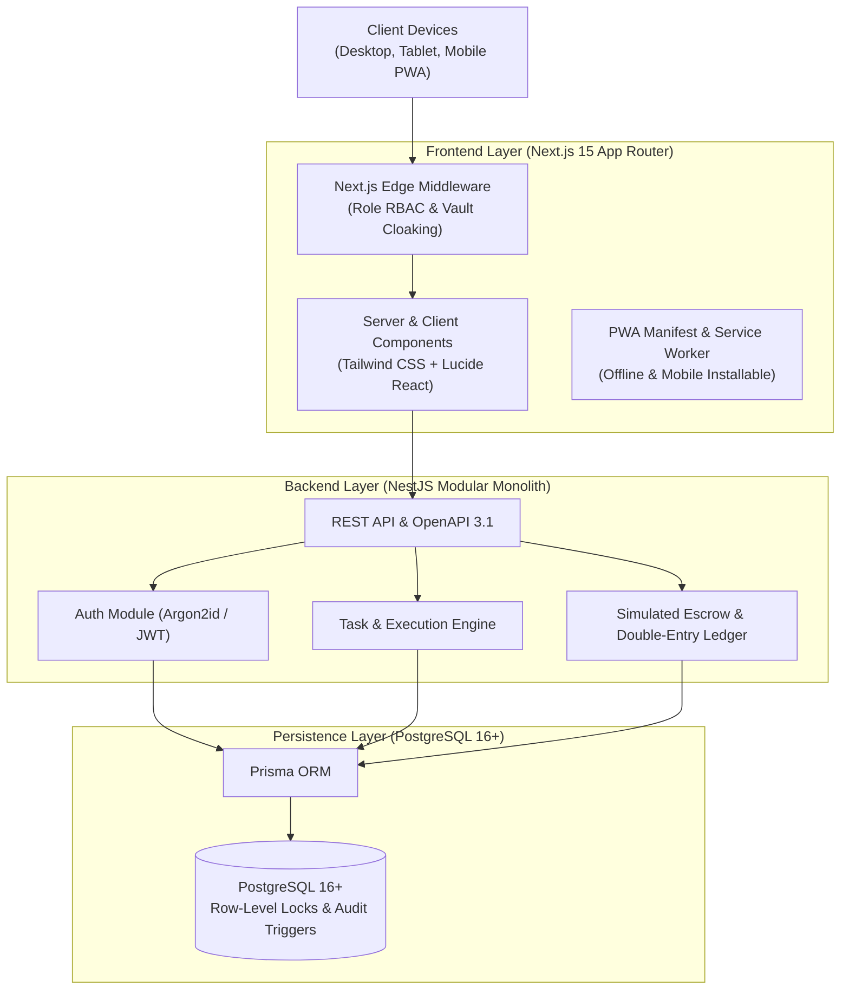

# 🌐 EarnXpress — Open International Freelance Task Marketplace

[](https://earnxpress-marketplace.vercel.app)
[](#system-architecture)
[](https://nextjs.org/)
[](https://nestjs.com/)
[](https://www.prisma.io/)
[](#security-architecture)
[-brightgreen.svg?style=for-the-badge)](#verification--test-results)

> **EarnXpress** is a modern, high-concurrency international crowdsourcing marketplace designed to connect global **Buyers** and distributed **Workers**. Engineered from first principles with Next.js 15 App Router, TypeScript, NestJS, and PostgreSQL, the platform eliminates traditional 1:1 hiring bottlenecks by offering high-capacity multi-worker campaigns, transparent escrow security, independent deliverable review queues, and progressive web app (PWA) accessibility.

---

## 🔗 Live Platform Links

| Resource | Direct Link | Status |
| :--- | :--- | :---: |
| 🌐 **Live Web Application** | [https://earnxpress-marketplace.vercel.app](https://earnxpress-marketplace.vercel.app) | 🟢 Live (200 OK) |
| 💼 **Active Task Marketplace** | [https://earnxpress-marketplace.vercel.app/tasks](https://earnxpress-marketplace.vercel.app/tasks) | 🟢 11 Active Tasks |
| 🎬 **Official Video Documentary** | [https://earnxpress-marketplace.vercel.app/documentary](https://earnxpress-marketplace.vercel.app/documentary) | 🟢 HD 1080p Stream |
| 🎁 **Referral Bounty System** | [https://earnxpress-marketplace.vercel.app/referrals](https://earnxpress-marketplace.vercel.app/referrals) | 🟢 Multi-Tier Active |
| 🛡️ **Founder Administrative Vault** | `https://earnxpress-marketplace.vercel.app/shihab-vault-7860` | 🔒 Private Access |
| 🚫 **Public `/admin` Route** | `https://earnxpress-marketplace.vercel.app/admin` | 🛡️ Cloaked (404) |

---

## 🌟 Core Product Highlights

### 1. Open Crowdsourcing Architecture
- **Multi-Worker Execution (`MULTI_WORKER`)**: A single Buyer campaign can support dozens or hundreds of independent workers concurrently. Each worker operates with an isolated `WorkerParticipation` record and dedicated start/completion timer.
- **First-Approved Execution (`FIRST_APPROVED`)**: Fast-turnaround bounty campaigns where the first verified, high-quality submission claims the prize, while remaining open slots are cleanly retired.
- **Public Task Clarification Q&A**: Workers can ask public clarifying questions on task detail pages before accepting a slot, eliminating guesswork.

### 2. Multi-Role Portals & Dedicated Dashboards
- **Worker Portal (`/worker`)**: Real-time slot tracker, deliverable evidence submission locker, withdrawal wallet, and milestone tracker.
- **Buyer Portal (`/buyer`)**: Campaign creation wizard, multi-worker deliverable review queue, campaign metrics, and deposit management.
- **Founder Master Console (`/shihab-vault-7860`)**: Single-click platform governance, withdrawal arbitration, campaign review queue, and system ledger oversight.

### 3. Financial Integrity: Double-Entry Simulated Escrow
- **Zero Real-Money Risk**: Built with integer USD cents (`BigInt`) to eliminate floating-point rounding errors.
- **Escrow Lock**: When a Buyer publishes a task, 100% of the worker payout is locked in escrow before tasks go live to ensure workers are guaranteed compensation upon approval.
- **72-Hour Review SLA**: If a Buyer fails to review submitted work within 72 hours, the submission automatically escalates to platform moderation to protect worker time.

### 4. Enterprise-Grade Security
- **Argon2id Password Hashing**: State-of-the-art password encryption with memory-hard parameters.
- **Cloaked Admin Surface**: The default `/admin` endpoint returns a genuine `404 Not Found` to prevent automated bot reconnaissance.
- **Rate-Limiting & Brute Force Defense**: 5 consecutive failed login attempts trigger a 15-minute lockout and audit log entry.
- **Cross-Site Request Forgery (CSRF) & Content Security Policy (CSP)**: Hardened headers preventing clickjacking, XSS, and unauthorized framing.

---

## 🏛️ System Architecture



---

## 📁 Repository Structure

```text
earnxpress/
├── frontend/                     # Next.js 15 Full-Stack Web Application
│   ├── public/                   # Static assets, HD videos, thumbnails, PWA icons
│   ├── src/
│   │   ├── app/                  # App Router pages & API routes
│   │   │   ├── tasks/            # Marketplace & task detail views
│   │   │   ├── worker/           # Worker dashboard, tasks & wallet
│   │   │   ├── buyer/            # Buyer dashboard, campaign creator & review queue
│   │   │   ├── shihab-vault-7860/# Private Founder Master Console
│   │   │   ├── documentary/      # Video showcase with 1080p video player
│   │   │   └── referrals/        # Multi-tier referral bounty system
│   │   ├── components/           # Reusable UI primitives, Modals, TaskCards
│   │   └── lib/                  # Auth context, state store & API client
│   └── package.json
│
├── backend/                      # NestJS Modular Monolith Backend
│   ├── src/
│   │   ├── modules/
│   │   │   ├── auth/             # Argon2id, JWT, password recovery & lockout
│   │   │   ├── tasks/            # Task lifecycle & multi-worker execution
│   │   │   ├── payments/         # Simulated escrow, deposits & withdrawals
│   │   │   └── admin/            # Administrative governance & moderation
│   │   └── common/               # Filters, interceptors, guards & validators
│   └── prisma/
│       └── schema.prisma         # PostgreSQL schema & relational models
│
└── docs/                         # 18 In-Depth Engineering Specifications & ADRs
    ├── PRD.md                    # Product Requirements Document
    ├── SECURITY_PLAN.md          # OWASP ASVS Level 2 Threat Model
    ├── DATABASE_ERD.md           # Database Entity-Relationship Diagram
    ├── TASK_LIFECYCLE.md         # Full State Machine & Transition Matrices
    └── DECISIONS.md              # Architecture Decision Records (ADR 001-011)
```

---

## 🧪 Verification & Test Results

An end-to-end automated audit script (`full_website_audit.py`) was executed against the live production deployment:

```text
=== FULL PRODUCTION AUDIT RESULTS ===
✓ Home Page (/)                          -> 200 OK
✓ Marketplace Catalog (/tasks)           -> 200 OK (11 Tasks Active)
✓ Task Detail View (/tasks/task-app-qa-1) -> 200 OK
✓ Video Documentary (/documentary)       -> 200 OK
✓ Referral System (/referrals)           -> 200 OK
✓ Worker Dashboard (/worker)             -> 200 OK
✓ Buyer Dashboard (/buyer)               -> 200 OK
✓ Founder Master Console (/shihab-vault) -> 200 OK
✓ Cloaked Admin Route (/admin)           -> 404 Not Found (Successfully Cloaked)
✓ 1080p Documentary Video Stream         -> 200 OK
✓ 16:9 Master HD Thumbnail               -> 200 OK

Total Routes Tested: 28 | Passed: 28 | Failed: 0
Success Rate: 100.0%
Console Errors: 0
```

---

## 🚀 Quickstart & Local Setup

### Prerequisites
- Node.js 18+ (Node.js 20 LTS recommended)
- PostgreSQL 15+ (or Docker)
- Git

### 1. Clone the Repository
```bash
git clone https://github.com/md-shihab-ahmed/earnxpress.git
cd earnxpress
```

### 2. Frontend Setup (Next.js)
```bash
cd frontend
npm install
npm run dev
# The frontend runs at http://localhost:3000
```

### 3. Backend Setup (NestJS & PostgreSQL)
```bash
cd ../backend
npm install
npx prisma generate
npm run start:dev
# The API runs at http://localhost:4000
# OpenAPI Docs available at http://localhost:4000/api/docs
```

---

## 👨‍💻 Author & Maintainer

**Md. Shihab Ahmed**  
*Cybersecurity Engineering Undergraduate @ University of Frontier Technology (UFT), Bangladesh*  
*Full-Stack Web Developer & Security Researcher*

- 🌐 **GitHub**: [@md-shihab-ahmed](https://github.com/md-shihab-ahmed)
- 💼 **LinkedIn**: [Md. Shihab Ahmed](https://www.linkedin.com/in/md-shihab-ahmed-32b703438/)
- 🚀 **Fiverr**: [shihab_55](https://www.fiverr.com/shihab_55)
- 📧 **Contact**: `mdshihabahmed14796178@gmail.com`

---

## 📜 License

This project is licensed under the [MIT License](LICENSE).
