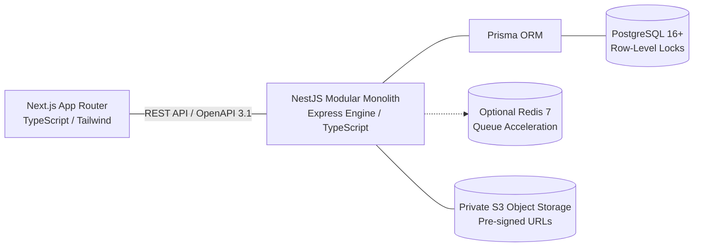

# EarnXpress — Open International Task Marketplace

[](#core-architecture)
[%20%7C%20TypeScript-red.svg)](https://nestjs.com/)
[](https://nextjs.org/)
[](https://www.prisma.io/)
[](docs/SECURITY_PLAN.md)
[](PROJECT_STATUS.md)

**EarnXpress** is an open international freelance task marketplace connecting global **Buyers** and distributed **Workers**. Engineered from first principles for multi-participant crowdsourcing, transparent capacity allocation, independent work records, and tamper-evident auditability.

> [!IMPORTANT]
> **Active Workspace Recommendation**: To work with this project directly, please open or set your workspace directory to:  
> `C:\Users\acer\.gemini\antigravity\scratch\earnxpress`

---

## 1. Core Product Philosophy: Open Marketplace

EarnXpress is explicitly **NOT** a 1:1 direct hiring board where a Buyer only works with a single Worker after off-platform negotiation. It is an open, high-capacity task marketplace:
- **Zero Gatekeeping**: Any registered Buyer can publish tasks with configurable capacity; any registered Worker can discover and accept open slots without prior personal contact.
- **Multiple Workers Per Task**: Tasks support dozens or hundreds of concurrent Workers, each operating with an independent `WorkerParticipation` record. One Worker's delay or failure never impacts other participants.
- **Two Distinct Task Models**:
  1. `MULTI_WORKER`: Multiple workers complete independently; each approved worker receives unit demo earnings.
  2. `FIRST_APPROVED`: Multiple workers compete concurrently; the first valid approved submission wins the prize; remaining work is gracefully closed.
- **In-Platform Communication**: Public task Q&A threads allow workers to clarify instructions before accepting; private messaging supports in-progress collaboration.
- **Verifiable Progress Milestones**: Progress percentages are derived strictly from completed, verified deliverable checkpoints (no self-reported percentages).
- **The 72-Hour `REVIEW_OVERDUE` Policy**: Buyer inactivity past 72 hours transitions submissions to `REVIEW_OVERDUE` and escalates to Platform Moderation for evidence review. Funds are never blindly auto-approved.

---

## 2. Core Technology Stack



- **Frontend**: Next.js 15 (App Router), TypeScript, Tailwind CSS, Shadcn UI / Radix primitives, Lucide icons, TanStack Query.
- **Backend**: NestJS (v10+), TypeScript, Express HTTP adapter, Prisma ORM, Passport.js, Swagger/OpenAPI, class-validator.
- **Database**: PostgreSQL 16+ (Row-level concurrency locks, ICU collations, check constraints).
- **Simulated Financial Engine**: Double-entry ledger in integer USD cents. Zero real-money movement. Prominent DEMO branding.
- **Optional Services**: Redis 7 (queue acceleration) and MinIO (local S3 storage) are optional to keep local setup friction-free.

---

## 3. Comprehensive Documentation Catalog

The project's architectural specifications, business rules, schemas, and system designs are fully documented in [`docs/`](docs/):

| # | Specification Document | Description |
| :---: | :--- | :--- |
| 1 | [**Product Requirements Document (PRD)**](docs/PRD.md) | Open marketplace philosophy, multi-worker architecture, 2 task models, and participation dashboard. |
| 2 | [**Business Rules & Governance**](docs/BUSINESS_RULES.md) | Proposed fees, 3-failure surcharge ceiling, configurable start deadlines, 72h overdue review, and cancellations. |
| 3 | [**End-to-End User Flows**](docs/USER_FLOWS.md) | Public discovery, Q&A clarification, slot acceptance, milestone tracking, and overdue escalation. |
| 4 | [**Task Lifecycle & State Machine**](docs/TASK_LIFECYCLE.md) | Parent Task state machine & independent Worker Participation state machine with full transition matrices. |
| 5 | [**Edge Cases & Race Conditions**](docs/EDGE_CASES.md) | Slot stampedes, first-approved concurrency, start timeouts, pausing active tasks, and fractional cent math. |
| 6 | [**Identity Verification Architecture**](docs/IDENTITY_VERIFICATION.md) | Country-independent taxonomy, provider adapter pattern, mock KYC demo, and privacy boundaries. |
| 7 | [**Security Architecture & Threat Model**](docs/SECURITY_PLAN.md) | OWASP ASVS Level 2, Argon2id, secure cookies, re-authentication, BOLA defenses, and DB audit triggers. |
| 8 | [**Database ERD & Prisma Schema**](docs/DATABASE_ERD.md) | PostgreSQL 16 schema with `Task`, `TaskSlot`, `WorkerParticipation`, `Submission`, and `DemoLedger` models. |
| 9 | [**RESTful API Specification**](docs/API_SPECIFICATION.md) | OpenAPI 3.1 endpoints, DTO contracts, Express adapter evaluation, and standard JSON envelopes. |
| 10 | [**Role & Permission Matrix**](docs/PERMISSION_MATRIX.md) | Granular RBAC and ABAC tables covering all 5 roles, Owner root authority, and re-authentication rules. |
| 11 | [**Design System Specification**](docs/DESIGN_SYSTEM.md) | Deep Navy & Teal theme, Task Participation Dashboard, milestone tracker, and DEMO financial badges. |
| 12 | [**Website Sitemap & Parity Map**](docs/WEBSITE_SITEMAP.md) | Next.js App Router tree, public catalog, buyer/worker portals, and Android screen parity mapping. |
| 13 | [**Simulated Financial Engine**](docs/FINANCIAL_SIMULATION.md) | Double-entry demo chart of accounts, integer cent math, demo faucet, and timestamped FX snapshots. |
| 14 | [**Quality Assurance Test Plan**](docs/QA_TEST_PLAN.md) | Vitest, Supertest, and Playwright test suites, including 50x parallel slot concurrency race tests. |
| 15 | [**Deployment & DevOps Plan**](docs/DEPLOYMENT_PLAN.md) | Express vs Fastify evaluation, lean Docker Compose, zero-downtime migrations, and health probes. |
| 16 | [**Internationalization (i18n)**](docs/INTERNATIONALIZATION.md) | English launch, Bangla priority expansion, original instruction preservation, and translated badges. |
| 17 | [**Administrative Governance**](docs/ADMIN_SPECIFICATION.md) | Owner prerogatives, overdue review queue, dispute arbitration console, and immutable audit explorer. |
| 18 | [**Architecture Decision Records (ADRs)**](docs/DECISIONS.md) | Formal records ADR-001 through ADR-011 and inventories of proposed, deferred, and legal review items. |

---

## 4. Root Project Governance Files

- [**PROJECT_STATUS.md**](PROJECT_STATUS.md): Master audit completion status and milestone readiness verification.
- [**ROADMAP.md**](ROADMAP.md): Dependency-aware 7-phase implementation roadmap.
- [**BUGS.md**](BUGS.md): Defect register, standard bug reporting template, and architectural watchpoints.
- [**CHANGELOG.md**](CHANGELOG.md): Historical log of specification versions (v0.1.0 initial $\to$ v0.2.0 master audit).
- [**AGENTS.md**](AGENTS.md): Strict operational standards and invariants for autonomous AI coding agents.

---

## 5. Backend Foundation & Quickstart

The backend is structured as a production NestJS modular monolith under [`backend/`](backend/):

```bash
# 1. Start local PostgreSQL (and optional Redis)
docker compose up -d

# 2. Enter backend directory & generate Prisma client
cd backend
npm install
npx prisma generate

# 3. Apply database schema & migration
npx prisma migrate dev

# 4. Run automated test suites (40 unit tests, 5 E2E tests)
npm test
npm run test:e2e

# 5. Build and launch development server
npm run build
npm run start:dev
```

- **OpenAPI / Swagger Explorer**: `http://localhost:4000/api/docs`
- **Health Probe**: `http://localhost:4000/api/v1/health`
- **Demo Financial Faucet**: `POST http://localhost:4000/api/v1/demo-finance/faucet`

---

## 6. Frontend Website & Quickstart

The frontend is a production **Next.js 14 App Router** application built under [`frontend/`](frontend/):

```bash
# 1. Enter frontend directory
cd frontend

# 2. Run production build
npm run build

# 3. Launch development server
npm run dev
# Website available at: http://localhost:3000
```

### Complete Route Map
| Route | Description |
| :--- | :--- |
| `/` | Homepage with hero, live metrics, pillars, and featured task previews. |
| `/tasks` | Open Marketplace Catalog with search and model filters. |
| `/tasks/[id]` | Task Details page with **Task Participation Dashboard** & slot claim. |
| `/worker` | Worker Dashboard with active slots and execution status. |
| `/worker/tasks/[id]` | Task Execution Workspace with **MilestoneTracker** & submission form. |
| `/worker/wallet` | Demo Wallet with **$1,000 Faucet Button** & transaction ledger. |
| `/buyer` | Buyer Dashboard with active campaign management. |
| `/buyer/tasks/new` | **Five-Step Task Creation Wizard** with live escrow calculation. |
| `/buyer/submissions`| Submissions Review Queue (Approve payout, Revision, Reject). |
| `/buyer/wallet` | Buyer Demo Wallet for campaign funding. |
| `/admin` | Staff Governance Console (sanctions, overdue review triage, audit explorer). |
| `/login` | Sign In with **1-click demo profiles** (Worker, Buyer, Admin). |
| `/register` | Registration with role toggle (Worker vs Buyer). |
| `/about`, `/help` | Platform mission, rules, and 72h SLA FAQ. |
