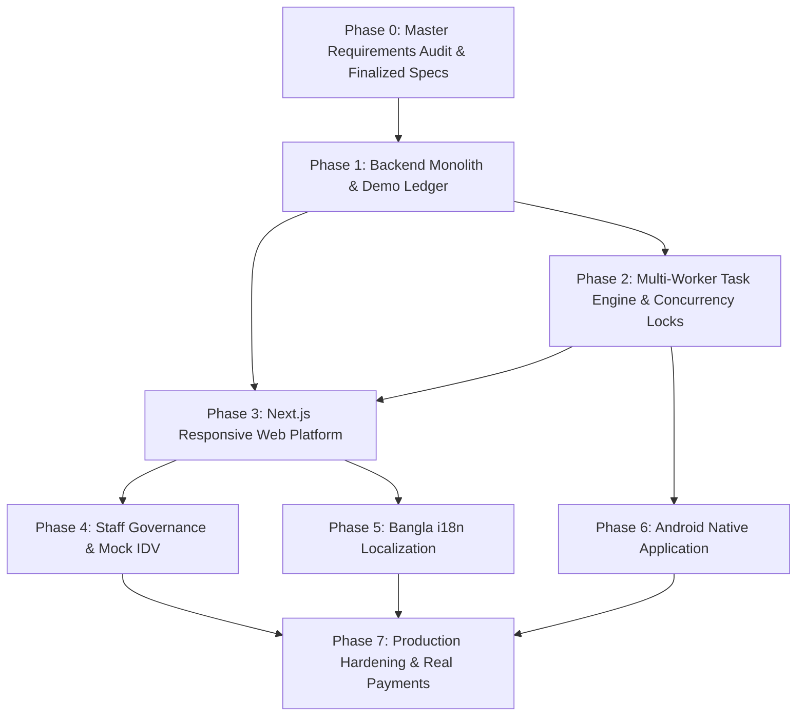

# EarnXpress — Phased Development Roadmap

| Metadata | Details |
| :--- | :--- |
| **Document Version** | 1.1.0-AUDITED |
| **Project Code** | EX-ROADMAP |
| **Document Status** | Approved for Execution |
| **Classification** | Master Development Roadmap |
| **Last Updated** | 2026-11-03 |

---

## 1. Roadmap Dependency Graph

---

## 2. Phase Breakdown & Deliverables

### Phase 0: Master Requirements Audit & Foundation Specs `[CONFIRMED - 100% COMPLETE]`
- **Status**: **100% COMPLETE & AUDITED**
- **Deliverables**:
  - Author and audit all 18 domain specifications in `docs/` and 6 root governance files.
  - Establish Open Marketplace principles, multi-worker independent records, and 2 distinct task models.
  - Finalize double-entry demo ledger math in integer USD cents, 72h `REVIEW_OVERDUE` escalation, and Express NestJS engine.

---

### Phase 1: Backend Modular Monolith & Core Task Marketplace `[CONFIRMED - 100% COMPLETE]`
- **Dependencies**: Phase 0.
- **Status**: **100% COMPLETE & VERIFIED** (40/40 Unit Tests, 5/5 E2E Tests, `nest build` code 0).
- **Key Deliverables Achieved**:
  - NestJS 10 backend modular monolith using TypeScript and Express engine.
  - Complete PostgreSQL 16 Prisma schema (16 domain models) with migration script `0_init/migration.sql`.
  - Database-level check constraints (`chk_task_slots_valid`, `chk_demo_balance_non_negative`) and PostgreSQL trigger `trg_audit_logs_immutable`.
  - Auth & Security: Argon2id password hashing, short-lived JWT access tokens, HttpOnly refresh cookie rotation, TOTP MFA architecture, and `@RequireReAuth` guard.
  - Demo Financial Engine: Double-entry ledger executing strictly in integer USD cents (`BIGINT`), faucet endpoint (`POST /demo-finance/faucet`), escrow reservation, and slot payout disbursal.
  - Multi-Worker Open Marketplace Task Module: 5-step wizard creation, row-level locking concurrency (`SELECT ... FOR UPDATE`), participation tracking, deliverable submissions, and buyer evaluation (`APPROVE`, `REQUEST_REVISION`, `REJECT`).
  - Admin & Governance: Platform Owner privilege isolation, user sanctions, and immutable audit logging.
  - Full automated testing suite passing 100%.

---

### Phase 2: Dispute Resolution & Evidence Management `[CONFIRMED - 100% COMPLETE]`
- **Status**: **100% COMPLETE & VERIFIED** (65/65 Unit Tests passing, 12/12 E2E Stages passing).
- **Key Deliverables Achieved**:
  - Secure Evidence Management Module (`EvidenceModule`) with multi-format support (images, PDF, video, ZIP, text/CSV).
  - Magic-byte binary verification blocking MIME spoofing, plus built-in malware scanner interface (`IMalwareScanner`).
  - SHA-256 cryptographic hashing and private filesystem storage.
  - HMAC-SHA256 signed time-limited download URLs with participation authorization checks.
  - Public Task Q&A conversation threads and private Buyer-Worker 1-on-1 slot messaging.
  - Dispute Resolution Engine (`DisputesModule`) supporting formal dispute filing, evidence attachment, and standardized reason codes.
  - Comprehensive Arbitration Dossier inspection for platform moderators.
  - Four distinct arbitration verdicts (`SETTLE_WORKER`, `REFUND_BUYER`, `SPLIT_SETTLEMENT`, `DISMISS`) executing atomic double-entry ledger settlement without floating-point errors.
  - Frontend `EvidenceUploader`, `DisputeModal`, `TaskQnA`, and Admin "Dispute Arbitration Console" with interactive dossier review and split ruling tools.

---

### Phase 3: Android Native Mobile Application & Production Hardening `[CONFIRMED - NEXT PHASE]`
- **Key Deliverables**:
  - Initialize Next.js 15 (App Router) with Tailwind CSS, Shadcn UI / Radix primitives, and Lucide icons.
  - Implement Design System tokens (Deep Navy, Teal accent, Light and Dark themes, WCAG 2.1 AA compliance).
  - Build Public Marketplace: Landing page, faceted Task Explorer (`/tasks`), and Task Details with **Task Participation Dashboard**.
  - Build Buyer Workspace: 5-step Task Creation Wizard, Campaign Analytics, Submissions Queue, and Q&A management.
  - Build Worker Workspace: Execution Workspace, Milestone Progress Tracker, and Evidence Upload form.
  - Build Demo Wallet: Balance cards, \$1,000 faucet button, and transaction history with prominent DEMO badges.
  - Build Blind Two-Way Review System with 14-day reveal countdown.

---

### Phase 4: Staff Governance Console & Mock Identity Verification `[CONFIRMED]`
- **Dependencies**: Phase 3.
- **Key Deliverables**:
  - Implement Demonstration KYC interface with `MockVerificationProvider` (zero real biometrics).
  - Build Staff Governance Portal (`/admin`):
    - Platform Owner console: Staff role assignment and commission rate configuration.
    - Overdue Review Triage Queue: Adjudicate submissions unreviewed past 72h.
    - Dispute Arbitration Judicial Console: Evidence inspection and split settlement executor.
    - User Sanctions Engine: Warnings, slot restrictions, suspensions, and bans.
    - Immutable Audit Explorer with JSON diffs.

---

### Phase 5: Internationalization (Bangla `bn-BD` Rollout) `[CONFIRMED]`
- **Dependencies**: Phase 3.
- **Key Deliverables**:
  - Integrate `next-intl` localization middleware and locale switcher.
  - Complete full Bangla translation dictionary (`messages/bn/*.json`).
  - Configure PostgreSQL ICU collation for native Bangla alphabetical sorting.
  - Implement translation badge UI: `Translated from English (Show Original)`.

---

### Phase 6: Native Android Mobile Application `[DEFERRED]`
- **Dependencies**: Phase 2, Phase 3.
- **Key Deliverables**:
  - Initialize Kotlin Android project using Jetpack Compose and Material 3.
  - Consume existing OpenAPI 3.1 RESTful endpoints with Android Keystore token storage.
  - Integrate Firebase Cloud Messaging (FCM) for push notifications.
  - Mirror web deep-links (`earnxpress://tasks/{id}`).

---

### Phase 7: Production Hardening, Legal Approvals & Commercial Launch `[DEFERRED / LEGAL REVIEW]`
- **Dependencies**: Phase 4, Phase 5, Phase 6.
- **Key Deliverables**:
  - Platform Owner and Legal Counsel review of consecutive failure surcharge (`DEC-LEG-01`).
  - Contract and integrate commercial KYC vendor (Sumsub/Veriff) replacing mock provider (`DEC-DEF-02`).
  - Integrate live payment gateways (Stripe Connect / local processors) replacing simulated faucet (`DEC-DEF-03`).
  - Third-party penetration testing and OWASP ASVS Level 2 compliance certification.
