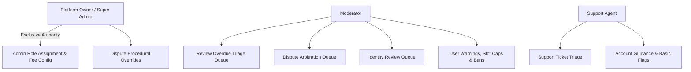

# EarnXpress — Administrative Governance & Moderation Specification

| Metadata | Details |
| :--- | :--- |
| **Document Version** | 1.1.0-AUDITED |
| **Project Code** | EX-ADMIN |
| **Document Status** | Approved for Development Foundation |
| **Classification** | Master Administration Specification |
| **Last Updated** | 2026-11-03 |
| **Authority Model** | Platform Owner Root Authority with RBAC Delegation |

---

## 1. Administrative Authority Structure & Guardrails

EarnXpress maintains strict separation between application-level governance and infrastructure operations:

### 1.1 Inviolable Rules of Administrative Governance
1. **The Root Invariant**: The **Platform Owner** is the project creator and holds the highest application-level authority. No other role can demote, ban, or alter the Owner account.
2. **Sole Role Granting**: Only the Platform Owner can assign, elevate, or revoke staff roles (`SUPER_ADMIN`, `MODERATOR`, `SUPPORT_AGENT`).
3. **Application vs. Infrastructure Separation**: Administrative staff accounts operate strictly inside the application data model. They do not possess server root access, AWS IAM console access, or direct database superuser credentials.
4. **Mandatory Audit Rationale**: Every administrative mutation (banning a user, arbitrating a dispute, adjudicating an overdue review) requires a written `reason` stored immutably in `audit_logs`.

---

## 2. Core Administrative Consoles

### 2.1 Overdue Review Triage Console (`/admin/review-overdue`)
- **Purpose**: Adjudicates worker submissions that have remained unreviewed by Buyers past the 72-hour SLA and 24-hour grace window (total 96 hours).
- **Interface**:
  - Displays immutable task instruction version and objective acceptance criteria checklist.
  - Displays Worker submitted files, text notes, URLs, and submission timestamp.
  - Displays communication log between Buyer and Worker.
- **Rulings**:
  - `APPROVED_BY_STAFF`: Criteria confirmed met by evidence. Escrow released to Worker (-4%). Buyer penalized for delinquency.
  - `REJECTED_BY_STAFF`: Deliverables do not satisfy published criteria. Escrow refunded to Buyer.
- **Invariant**: Simulated earnings are never released without an explicit, valid review decision.

### 2.2 Dispute Arbitration Judicial Console (`/admin/disputes/[id]`)
- **Purpose**: Binding arbitration for rejected submissions appealed by Workers.
- **Rulings**:
  - `VERDICT_WORKER_FULL`: 100% of slot funds disbursed to Worker.
  - `VERDICT_BUYER_FULL`: 100% of slot funds returned to Buyer available demo balance.
  - `VERDICT_SPLIT`: Custom percentage split (e.g. 50/50, 70/30) computed to exact integer USD cents.

### 2.3 User Sanctions & Capacity Restriction Engine (`/admin/users/[id]/sanction`)
- **Sanctions Matrix**:
  1. *Policy Warning*: In-app acknowledgment required.
  2. *Worker Slot Restriction*: Limits worker to 1 concurrent active task slot during quality probation.
  3. *Temporary Suspension*: 7, 14, or 30-day session lockout.
  4. *Permanent Ban*: Identity hash blacklisted, IP subnet flagged, active slots cancelled.

### 2.4 Platform Fee & Demo Financial Console (Owner Only)
- Real-time balance sheets: Total virtual USD minted, total escrow locked, total platform commission collected.
- Fee configuration controls:
  - Buyer Platform Surcharge (Default: 2.0%).
  - Worker Commission Fee (Default: 4.0%).
  - 3-Failure Penalty Surcharge (Default: 2.0%).

---

## 3. Tamper-Evident Audit Explorer (`/admin/audit-logs`)

Authorized staff can inspect historical system mutations:
- Filters: Actor Role, Action Type, Target Resource, Date Range, IP Address.
- Side-by-side JSON diffs comparing `previous_state` and `new_state`.
- **Database Immutability**: No edit or delete buttons exist in the UI; PostgreSQL row-level triggers unconditionally reject `UPDATE` and `DELETE` commands at the storage engine layer.
