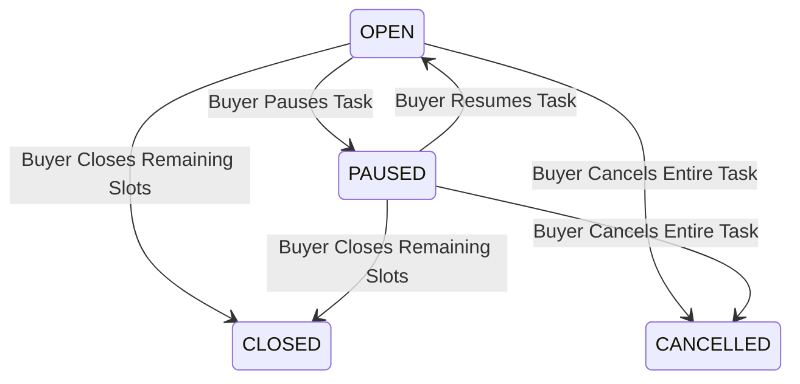

# EarnXpress — Business Rules & Governance Specification

| Metadata | Details |
| :--- | :--- |
| **Document Version** | 1.1.0-AUDITED |
| **Project Code** | EX-RULES |
| **Document Status** | Approved for Development Foundation |
| **Classification** | Master Governance Specification |
| **Last Updated** | 2026-11-03 |

---

## 1. Principles of Marketplace Integrity

EarnXpress operates under five foundational principles:
1. **Open Marketplace Principle `[CONFIRMED]`**: Any registered Buyer may publish tasks; any registered Worker may discover and accept open slots without pre-existing relationships or off-platform negotiations.
2. **Worker Independence Principle `[CONFIRMED]`**: On multi-worker tasks, every Worker operates with an independent participation record. One Worker's failure, rejection, or delay never impacts another Worker's standing or earnings.
3. **Objective Evidence Over Subjective Claims `[CONFIRMED]`**: Task reviews, progress milestones, rejections, and cancellation settlements must be substantiated by verifiable deliverable evidence. Neither self-declared progress percentages nor unsupported Buyer rejections carry legal or financial weight.
4. **Never Release Without Settlement `[CONFIRMED]`**: Buyer inactivity must not lead to blind automated fund release. Unreviewed submissions transition to `REVIEW_OVERDUE` and escalate to authorized human moderation.
5. **Separation of Real and Demo Systems `[CONFIRMED]`**: MVP operates strictly on simulated virtual currencies. Every balance, transaction, and ledger entry must be prominently branded as **DEMO**.

---

## 2. Platform Commission & Financial Rules

### 2.1 Proposed Fee Structure `[PROPOSED]`
- **Buyer Platform Surcharge**: **2.0%** assessed upon task creation and demo escrow reservation.
  $$\text{Total Reserved Demo Escrow} = \text{Task Budget} \times 1.02$$
- **Worker Platform Commission**: **4.0%** deducted from the gross task payout upon successful approval.
  $$\text{Net Worker Demo Payout} = \text{Task Budget} \times 0.96$$
- **Platform Gross Margin**:
  $$\text{Platform Take} = (\text{Task Budget} \times 0.02) + (\text{Task Budget} \times 0.04) = 6.0\%$$
- **Governance Note**: These commission rates are `[PROPOSED]` and subject to final Platform Owner business approval before commercialization.

### 2.2 Consecutive Verified Failure Policy `[PROPOSED] [LEGAL REVIEW REQUIRED]`
- **Definition of Verified Failure**: A failure is strictly defined as an assignment where an administrative dispute or quality audit proved deliberate plagiarism, malicious data injection, or gross negligence.
- **Rule 2.2.1 (Rejection Alone != Failure)**: A standard Buyer rejection because a deliverable missed a checklist nuance does **NOT** count as a failure.
- **Rule 2.2.2 (The 3-Failure Threshold)**: If a Worker incurs three (3) consecutive verified failures without an intervening successful task completion, the platform marks the account `PENALTY_SURCHARGE_PENDING`.
- **Rule 2.2.3 (One-Time Extra 2% Surcharge)**: On the Worker's next successfully approved task, an additional 2.0% platform fee is deducted (Total Worker fee = $4.0\% + 2.0\% = 6.0\%$).
- **Rule 2.2.4 (Strict Non-Compounding Ceiling)**:
  - Financial percentage penalties **never compound** beyond the single 2.0% surcharge (no 8%, 10%, etc.).
  - The penalty is single-use and resets upon successful settlement.
- **Rule 2.2.5 (Operational Sanctions for Recidivism)**: Subsequent verified failures route to `STAFF_QUALITY_REVIEW` for slot restriction or account suspension rather than further financial deductions.
- **Legal Compliance Requirement**: This policy requires formal legal review in target jurisdictions to ensure full compliance with independent contractor regulations and wage/deduction laws.

---

## 3. Slot Acceptance, Capacity & Worker Timeout Rules

### 3.1 Elimination of 15-Minute Grace Period `[CONFIRMED]`
- The previously suggested arbitrary 15-minute reservation grace period is **permanently eliminated**.
- Slot acceptance is an atomic commitment.

### 3.2 Configurable Worker Capacity & Concurrency Protection `[CONFIRMED]`
- Every task defines a maximum worker capacity ($N$).
- Slot claims are executed within an ACID database transaction using row-level locking (`SELECT available_slots FROM tasks WHERE id = :id FOR UPDATE`).
- Two Workers can never acquire the same remaining slot. If `available_slots == 0`, subsequent attempts receive `HTTP 409 Conflict`.

### 3.3 Configurable Start Deadlines & Timeout Process `[CONFIRMED]`
- Buyers configure a task-specific start deadline (`start_deadline_hours`, e.g., 2h, 6h, 24h).
- The countdown begins the moment the Worker accepts the slot.
- **Timeout Warning**: At $75\%$ of the start deadline, an automated high-priority reminder is sent to the Worker.
- **Timeout Expiration**:
  - If the Worker fails to initiate activity (confirm commencement or submit preliminary milestone) before the start deadline:
    - Status transitions to `TIMEOUT_START_EXPIRED`.
    - The slot is atomically returned to the task's available capacity (`available_slots = available_slots + 1`).
    - The event is logged in the user's participation history with the documented reason: `"Worker failed to initiate work prior to start deadline."`
    - Workers are never silently dropped; explicit notifications are dispatched.

---

## 4. Task Management Controls (Pause, Close Slots, Cancel)

Buyers have granular operational controls over active tasks:

### 4.1 Pause Task (`PAUSE_TASK`) `[CONFIRMED]`
- **Effect**: Freezes the task from accepting new Workers.
- **Active Workers**: All currently active Workers continue their work completely unaffected.
- **Resumption**: Buyer can unpause the task at any time, returning it to `OPEN`.

### 4.2 Close Remaining Slots (`CLOSE_REMAINING_SLOTS`) `[CONFIRMED]`
- **Effect**: Permanently closes any unfilled, unclaimed slots.
- **Escrow Refund**: Unused reserved demo escrow allocated for those unfilled slots is immediately returned to the Buyer's available demo balance.
- **Active Workers**: Currently assigned Workers continue through normal submission and review until completion.

### 4.3 Cancel Task (`CANCEL_TASK`) `[CONFIRMED]`
- **Effect**: Terminates the task campaign.
- **Unclaimed Slots**: 100% of escrow for unclaimed slots is refunded to Buyer immediately.
- **Active Workers**:
  - Workers who have not submitted work are cancelled with zero rating penalty.
  - Workers with submitted or partially completed deliverables are evaluated based on **verified milestone evidence**.
  - **No Compensation on Self-Reported Stats**: Compensation is never calculated from self-declared progress percentages. Partial demo compensation is awarded strictly for verified deliverable milestones.

---

## 5. Review SLA & The 72-Hour `REVIEW_OVERDUE` Escalation Policy

### 5.1 The 72-Hour Standard Review Window `[CONFIRMED]`
- When a Worker submits deliverables, the slot transitions to `SUBMITTED`.
- The Buyer has 72 hours to review evidence against the objective acceptance criteria.
- **Warning Triggers**: At Hour 48, an automated reminder alert is sent to the Buyer.

### 5.2 Transition to `REVIEW_OVERDUE` (Hour 72) `[CONFIRMED]`
- If the Buyer takes no action by Hour 72:
  - Status updates to `REVIEW_OVERDUE`.
  - Inactivity **does NOT** automatically approve the submission or release funds.
  - Buyer is issued a critical 24-hour final response alert.
  - The submission is flagged in the **Staff Review Queue**.

### 5.3 Moderator Escalation & Adjudication (Hour 96) `[CONFIRMED]`
- If the Buyer remains inactive past the 24-hour final grace window (total 96 hours):
  - A Platform Moderator inspects the submission against the active version's acceptance criteria checklist.
  - **If criteria are satisfied**: Moderator executes `APPROVED_BY_STAFF`. Demo escrow is disbursed to Worker. Buyer receives an administrative inactivity penalty.
  - **If criteria are not satisfied**: Moderator executes `REJECTED_BY_STAFF`. Demo escrow is returned to Buyer.
  - **Settlement Guarantee**: Simulated earnings are **never** released without an explicit, valid review decision.

---

## 6. Submissions, Revisions & Anti-Abuse Rules

### 6.1 Objective Acceptance Criteria `[CONFIRMED]`
- Buyers must define at least two (2) discrete, testable acceptance criteria upon task creation.
- Rejection or revision requests must cite the specific criteria key that failed, accompanied by actionable written guidance.

### 6.2 Bounded Revisions `[CONFIRMED]`
- Revisions are capped (default: 2, maximum: 3).
- Revisions cannot be used by Buyers to introduce new scope outside the active task version.
- Workers have a 48-hour SLA to submit revised deliverables.

### 6.3 Evidence-Based Disputes `[CONFIRMED]`
- If a submission is rejected and the Worker maintains all criteria were met, either party can escalate to `DISPUTED`.
- Dispute arbitration reviews the immutable task instruction version, submitted files, and communication logs. Decisions are final.
