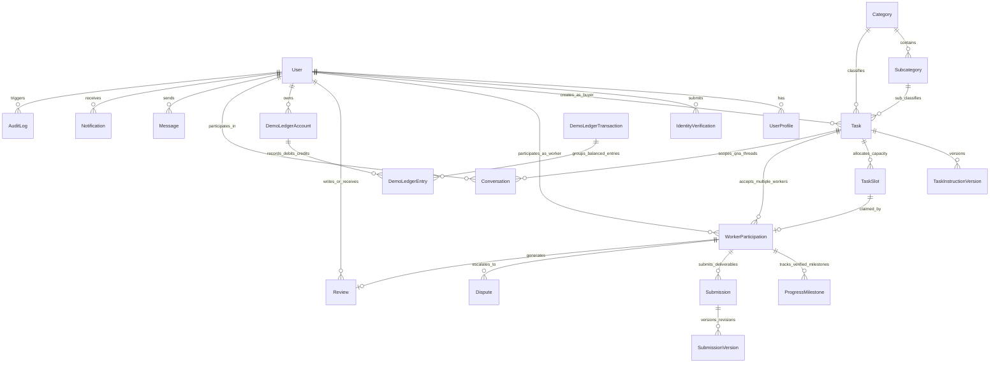

# EarnXpress — Database Schema & Entity Relationship Diagram (ERD)

| Metadata | Details |
| :--- | :--- |
| **Document Version** | 1.1.0-AUDITED |
| **Project Code** | EX-DATA |
| **Document Status** | Approved for Development Foundation |
| **Classification** | Master Data Architecture Specification |
| **Last Updated** | 2026-11-03 |
| **Target Engine** | PostgreSQL 16+ with Prisma ORM 5.x / 6.x |

---

## 1. High-Level Entity Relationship Diagram (Mermaid)



---

## 2. Prisma ORM Schema Specification

```prisma
datasource db {
  provider = "postgresql"
  url      = env("DATABASE_URL")
}

generator client {
  provider = "prisma-client-js"
}

// -------------------------------------------------------------
// ENUMS
// -------------------------------------------------------------

enum UserRole {
  PLATFORM_OWNER
  SUPER_ADMIN
  MODERATOR
  SUPPORT_AGENT
  BUYER
  WORKER
}

enum UserStatus {
  PENDING_VERIFICATION
  ACTIVE
  RESTRICTED
  SUSPENDED
  BANNED
}

enum IdvStatus {
  NOT_STARTED
  PENDING
  VERIFIED
  REJECTED
  MANUAL_REVIEW
}

enum TaskModel {
  MULTI_WORKER
  FIRST_APPROVED
}

enum TaskStatus {
  DRAFT
  PUBLISHED
  OPEN
  FULL
  PAUSED
  CLOSED
  COMPLETED
  CANCELLED
}

enum ParticipationStatus {
  IN_PROGRESS
  SUBMITTED
  UNDER_REVIEW
  REVISION_REQUESTED
  REVIEW_OVERDUE
  APPROVED
  REJECTED
  DISPUTED
  ABANDONED
  CANCELLED
  FIRST_APPROVED_CLOSED
}

enum DisputeStatus {
  OPEN
  UNDER_REVIEW
  EVIDENCE_SUBMITTED
  RESOLVED
  APPEALED
}

enum DemoAccountType {
  SYSTEM_FAUCET_POOL
  SYSTEM_REVENUE
  BUYER_AVAILABLE
  BUYER_ESCROW_RESERVED
  WORKER_AVAILABLE
  WORKER_PENDING_DISPUTE
}

// -------------------------------------------------------------
// USER & IDENTITY DOMAIN
// -------------------------------------------------------------

model User {
  id                   String        @id @default(uuid()) @db.Uuid
  email                String        @unique @db.VarChar(255)
  passwordHash         String        @db.VarChar(255)
  primaryRole          UserRole      @default(WORKER)
  status               UserStatus    @default(PENDING_VERIFICATION)
  emailVerified        Boolean       @default(false)
  mfaEnabled           Boolean       @default(false)
  mfaSecretEncrypted   String?       @db.VarChar(255)
  consecutiveFailures  Int           @default(0)
  hasPendingPenalty    Boolean       @default(false)
  tokenVersion         Int           @default(1)
  createdAt            DateTime      @default(now()) @db.Timestamptz(6)
  updatedAt            DateTime      @updatedAt @db.Timestamptz(6)

  profile              UserProfile?
  idvSubmissions       IdentityVerification[]
  createdTasks         Task[]                 @relation("BuyerTasks")
  participations       WorkerParticipation[]  @relation("WorkerParticipations")
  reviewsGiven         Review[]               @relation("ReviewsGiven")
  reviewsReceived      Review[]               @relation("ReviewsReceived")
  demoAccounts         DemoLedgerAccount[]
  conversations        ConversationParticipant[]
  sentMessages         Message[]
  notifications        Notification[]
  auditLogs            AuditLog[]             @relation("ActorAuditLogs")

  @@index([status])
  @@index([email])
}

model UserProfile {
  id                 String    @id @default(uuid()) @db.Uuid
  userId             String    @unique @db.Uuid
  displayName        String    @db.VarChar(100)
  headline           String?   @db.VarChar(150)
  bio                String?   @db.Text
  countryCode        String    @db.VarChar(2) // ISO-3166-1 alpha-2
  avatarUrl          String?   @db.VarChar(512)
  hourlyRateCents    BigInt    @default(0)
  availabilityStatus String    @default("AVAILABLE") @db.VarChar(32)
  reputationScore    Decimal   @default(5.00) @db.Decimal(3, 2)
  completionRate     Decimal   @default(100.00) @db.Decimal(5, 2)
  totalReviewsCount  Int       @default(0)
  createdAt          DateTime  @default(now()) @db.Timestamptz(6)
  updatedAt          DateTime  @updatedAt @db.Timestamptz(6)

  user               User      @relation(fields: [userId], references: [id], onDelete: Cascade)
  skills             UserSkill[]
}

model Skill {
  id        String      @id @default(uuid()) @db.Uuid
  name      String      @unique @db.VarChar(64)
  slug      String      @unique @db.VarChar(64)
  category  String      @db.VarChar(64)
  users     UserSkill[]
}

model UserSkill {
  userId    String   @db.Uuid
  skillId   String   @db.Uuid
  yearsExp  Int      @default(1)

  user      User     @relation(fields: [userId], references: [id], onDelete: Cascade)
  skill     Skill    @relation(fields: [skillId], references: [id], onDelete: Cascade)

  @@id([userId], [skillId])
}

model IdentityVerification {
  id                    String     @id @default(uuid()) @db.Uuid
  userId                String     @db.Uuid
  countryCode           String     @db.VarChar(2)
  documentType          String     @db.VarChar(32)
  documentNumberMasked  String     @db.VarChar(32)
  identityDedupHash     String     @unique @db.VarChar(64)
  status                IdvStatus  @default(PENDING)
  providerReferenceId   String?    @db.VarChar(128)
  confidenceScore       Int?
  riskFlags             String[]
  rejectionReason       String?    @db.Text
  reviewerNotes         String?    @db.Text
  reviewedById          String?    @db.Uuid
  createdAt             DateTime   @default(now()) @db.Timestamptz(6)
  reviewedAt            DateTime?  @db.Timestamptz(6)

  user                  User       @relation(fields: [userId], references: [id], onDelete: Cascade)

  @@index([status])
  @@index([userId])
}

// -------------------------------------------------------------
// TASK & CAPACITY DOMAIN (OPEN MARKETPLACE MULTI-WORKER)
// -------------------------------------------------------------

model Category {
  id            String        @id @default(uuid()) @db.Uuid
  name          String        @unique @db.VarChar(64)
  slug          String        @unique @db.VarChar(64)
  description   String?       @db.Text
  isActive      Boolean       @default(true)
  subcategories Subcategory[]
  tasks         Task[]
}

model Subcategory {
  id          String    @id @default(uuid()) @db.Uuid
  categoryId  String    @db.Uuid
  name        String    @db.VarChar(64)
  slug        String    @db.VarChar(64)
  isActive    Boolean   @default(true)

  category    Category  @relation(fields: [categoryId], references: [id], onDelete: Cascade)
  tasks       Task[]

  @@unique([categoryId, slug])
}

model Task {
  id                      String                  @id @default(uuid()) @db.Uuid
  buyerId                 String                  @db.Uuid
  categoryId              String                  @db.Uuid
  subcategoryId           String                  @db.Uuid
  taskModel               TaskModel               @default(MULTI_WORKER)
  title                   String                  @db.VarChar(150)
  status                  TaskStatus              @default(DRAFT)
  totalSlots              Int                     @default(1)
  availableSlots          Int                     @default(1)
  unitBudgetCents         BigInt                  // in USD integer cents
  totalEscrowCents        BigInt                  // total reserved demo escrow
  buyerFeeCents           BigInt                  // 2% platform surcharge
  workerFeeCents          BigInt                  // 4% platform commission
  maxRevisions            Int                     @default(2)
  startDeadlineHours      Int                     @default(6) // timeout to begin activity
  completionDurationHours Int                     @default(24) // total execution time
  reviewSlaHours          Int                     @default(72) // 72h review SLA
  currentVersionNumber    Int                     @default(1)
  winningParticipationId String?                 @db.Uuid // for FIRST_APPROVED model
  createdAt               DateTime                @default(now()) @db.Timestamptz(6)
  updatedAt               DateTime                @updatedAt @db.Timestamptz(6)

  buyer                   User                    @relation("BuyerTasks", fields: [buyerId], references: [id])
  category                Category                @relation(fields: [categoryId], references: [id])
  subcategory             Subcategory             @relation(fields: [subcategoryId], references: [id])
  instructionVersions     TaskInstructionVersion[]
  slots                   TaskSlot[]
  participations          WorkerParticipation[]
  conversations           Conversation[]
  reviews                 Review[]

  @@index([status])
  @@index([categoryId, subcategoryId])
  @@index([createdAt])
}

model TaskSlot {
  id            String              @id @default(uuid()) @db.Uuid
  taskId        String              @db.Uuid
  slotNumber    Int
  isClaimed     Boolean             @default(false)
  createdAt     DateTime            @default(now()) @db.Timestamptz(6)

  task          Task                @relation(fields: [taskId], references: [id], onDelete: Cascade)
  participation WorkerParticipation?

  @@unique([taskId, slotNumber])
  @@index([taskId, isClaimed])
}

model TaskInstructionVersion {
  id                         String           @id @default(uuid()) @db.Uuid
  taskId                     String           @db.Uuid
  versionNumber              Int
  descriptionMarkdown        String           @db.Text
  acceptanceCriteriaJson     Json
  deliverableRequirementsJson Json
  attachmentsJson            Json?
  createdById                String           @db.Uuid
  createdAt                  DateTime         @default(now()) @db.Timestamptz(6)

  task                       Task             @relation(fields: [taskId], references: [id], onDelete: Cascade)
  participations             WorkerParticipation[]

  @@unique([taskId, versionNumber])
}

// -------------------------------------------------------------
// WORKER PARTICIPATION & SUBMISSIONS DOMAIN
// -------------------------------------------------------------

model WorkerParticipation {
  id                    String                  @id @default(uuid()) @db.Uuid
  taskId                String                  @db.Uuid
  slotId                String                  @unique @db.Uuid
  workerId              String                  @db.Uuid
  instructionVersionId  String                  @db.Uuid
  status                ParticipationStatus     @default(IN_PROGRESS)
  startDeadlineAt       DateTime                @db.Timestamptz(6)
  executionDeadlineAt   DateTime                @db.Timestamptz(6)
  submittedAt           DateTime?               @db.Timestamptz(6)
  reviewOverdueAt       DateTime?               @db.Timestamptz(6)
  approvedAt            DateTime?               @db.Timestamptz(6)
  revisionsUsed         Int                     @default(0)
  progressPercentage    Int                     @default(0) // derived from verified milestones
  createdAt             DateTime                @default(now()) @db.Timestamptz(6)
  updatedAt             DateTime                @updatedAt @db.Timestamptz(6)

  task                  Task                    @relation(fields: [taskId], references: [id])
  slot                  TaskSlot                @relation(fields: [slotId], references: [id])
  worker                User                    @relation("WorkerParticipations", fields: [workerId], references: [id])
  instructionVersion    TaskInstructionVersion  @relation(fields: [instructionVersionId], references: [id])
  milestones            ProgressMilestone[]
  submissions           Submission[]
  dispute               Dispute?
  review                Review?

  @@index([taskId, status])
  @@index([workerId])
}

model ProgressMilestone {
  id                  String              @id @default(uuid()) @db.Uuid
  participationId     String              @db.Uuid
  milestoneOrder      Int
  title               String              @db.VarChar(120)
  description         String?             @db.Text
  isCompleted         Boolean             @default(false)
  isVerified          Boolean             @default(false)
  verifiedById        String?             @db.Uuid
  evidenceAttachments Json?
  completedAt         DateTime?           @db.Timestamptz(6)
  verifiedAt          DateTime?           @db.Timestamptz(6)

  participation       WorkerParticipation @relation(fields: [participationId], references: [id], onDelete: Cascade)

  @@unique([participationId, milestoneOrder])
}

model Submission {
  id                 String              @id @default(uuid()) @db.Uuid
  participationId    String              @db.Uuid
  currentVersion     Int                 @default(1)
  status             String              @default("PENDING_REVIEW") @db.VarChar(32)
  createdAt          DateTime            @default(now()) @db.Timestamptz(6)
  updatedAt          DateTime            @updatedAt @db.Timestamptz(6)

  participation      WorkerParticipation @relation(fields: [participationId], references: [id], onDelete: Cascade)
  versions           SubmissionVersion[]
}

model SubmissionVersion {
  id                  String          @id @default(uuid()) @db.Uuid
  submissionId        String          @db.Uuid
  versionNumber       Int
  textNotes           String?         @db.Text
  deliverableUrlsJson Json?
  fileAttachmentsJson Json?
  criteriaAttestationsJson Json
  revisionNotes       String?         @db.Text
  submittedAt         DateTime        @default(now()) @db.Timestamptz(6)

  submission          Submission      @relation(fields: [submissionId], references: [id], onDelete: Cascade)

  @@unique([submissionId, versionNumber])
}

model Dispute {
  id                  String              @id @default(uuid()) @db.Uuid
  participationId     String              @unique @db.Uuid
  initiatorId         String              @db.Uuid
  status              DisputeStatus       @default(OPEN)
  reasonCode          String              @db.VarChar(64)
  statement           String              @db.Text
  assignedModeratorId String?             @db.Uuid
  verdict             String?             @db.VarChar(32)
  workerPayoutCents   BigInt?
  buyerRefundCents    BigInt?
  arbitrationNotes    String?             @db.Text
  createdAt           DateTime            @default(now()) @db.Timestamptz(6)
  resolvedAt          DateTime?           @db.Timestamptz(6)

  participation       WorkerParticipation @relation(fields: [participationId], references: [id])
}

model Review {
  id                  String              @id @default(uuid()) @db.Uuid
  taskId              String              @db.Uuid
  participationId     String              @unique @db.Uuid
  reviewerId          String              @db.Uuid
  revieweeId          String              @db.Uuid
  overallRating       Int                 // 1 to 5
  communicationRating Int                 // 1 to 5
  qualityRating       Int                 // 1 to 5
  timelinessRating    Int                 // 1 to 5
  publicComment       String              @db.Text
  privateFeedback     String?             @db.Text
  isPublished         Boolean             @default(false)
  createdAt           DateTime            @default(now()) @db.Timestamptz(6)
  publishedAt         DateTime?           @db.Timestamptz(6)

  task                Task                @relation(fields: [taskId], references: [id])
  participation       WorkerParticipation @relation(fields: [participationId], references: [id])
  reviewer            User                @relation("ReviewsGiven", fields: [reviewerId], references: [id])
  reviewee            User                @relation("ReviewsReceived", fields: [revieweeId], references: [id])
}

// -------------------------------------------------------------
// FINANCIAL DOMAIN (SIMULATED DOUBLE-ENTRY DEMO LEDGER)
// -------------------------------------------------------------

model DemoLedgerAccount {
  id            String             @id @default(uuid()) @db.Uuid
  userId        String?            @db.Uuid
  accountType   DemoAccountType
  currency      String             @default("USD") @db.VarChar(3)
  balanceCents  BigInt             @default(0) // integer USD cents
  createdAt     DateTime           @default(now()) @db.Timestamptz(6)
  updatedAt     DateTime           @updatedAt @db.Timestamptz(6)

  user          User?              @relation(fields: [userId], references: [id])
  debitEntries  DemoLedgerEntry[]  @relation("DebitDemoAccount")
  creditEntries DemoLedgerEntry[]  @relation("CreditDemoAccount")

  @@unique([userId, accountType, currency])
}

model DemoLedgerTransaction {
  id            String             @id @default(uuid()) @db.Uuid
  referenceType String             @db.VarChar(64) // e.g. "TASK_ESCROW_LOCK", "FAUCET_INJECTION"
  referenceId   String             @db.Uuid
  description   String             @db.Text
  createdAt     DateTime           @default(now()) @db.Timestamptz(6)

  entries       DemoLedgerEntry[]

  @@index([referenceType, referenceId])
}

model DemoLedgerEntry {
  id                String                 @id @default(uuid()) @db.Uuid
  transactionId     String                 @db.Uuid
  debitAccountId    String                 @db.Uuid
  creditAccountId   String                 @db.Uuid
  amountCents       BigInt                 // integer USD cents
  createdAt         DateTime               @default(now()) @db.Timestamptz(6)

  transaction       DemoLedgerTransaction  @relation(fields: [transactionId], references: [id], onDelete: Cascade)
  debitAccount      DemoLedgerAccount      @relation("DebitDemoAccount", fields: [debitAccountId], references: [id])
  creditAccount     DemoLedgerAccount      @relation("CreditDemoAccount", fields: [creditAccountId], references: [id])

  @@index([transactionId])
}

// -------------------------------------------------------------
// IN-PLATFORM MESSAGING & COLLABORATION
// -------------------------------------------------------------

model Conversation {
  id           String                    @id @default(uuid()) @db.Uuid
  taskId       String?                   @db.Uuid
  isPublicQnA  Boolean                   @default(false)
  createdAt    DateTime                  @default(now()) @db.Timestamptz(6)
  updatedAt    DateTime                  @updatedAt @db.Timestamptz(6)

  task         Task?                     @relation(fields: [taskId], references: [id], onDelete: SetNull)
  participants ConversationParticipant[]
  messages     Message[]
}

model ConversationParticipant {
  id             String       @id @default(uuid()) @db.Uuid
  conversationId String       @db.Uuid
  userId         String       @db.Uuid
  joinedAt       DateTime     @default(now()) @db.Timestamptz(6)

  conversation   Conversation @relation(fields: [conversationId], references: [id], onDelete: Cascade)
  user           User         @relation(fields: [userId], references: [id], onDelete: Cascade)

  @@unique([conversationId, userId])
}

model Message {
  id             String       @id @default(uuid()) @db.Uuid
  conversationId String       @db.Uuid
  senderId       String       @db.Uuid
  content        String       @db.Text
  attachmentsJson Json?
  createdAt      DateTime     @default(now()) @db.Timestamptz(6)

  conversation   Conversation @relation(fields: [conversationId], references: [id], onDelete: Cascade)
  sender         User         @relation(fields: [senderId], references: [id], onDelete: Cascade)
}

// -------------------------------------------------------------
// NOTIFICATIONS & AUDIT GOVERNANCE
// -------------------------------------------------------------

model Notification {
  id        String   @id @default(uuid()) @db.Uuid
  userId    String   @db.Uuid
  type      String   @db.VarChar(64)
  title     String   @db.VarChar(150)
  body      String   @db.Text
  actionUrl String?  @db.VarChar(255)
  isRead    Boolean  @default(false)
  createdAt DateTime @default(now()) @db.Timestamptz(6)

  user      User     @relation(fields: [userId], references: [id], onDelete: Cascade)

  @@index([userId, isRead])
}

model AuditLog {
  id            String    @id @default(uuid()) @db.Uuid
  actorId       String    @db.Uuid
  actorRole     String    @db.VarChar(32)
  action        String    @db.VarChar(64)
  resourceType  String    @db.VarChar(64)
  resourceId    String    @db.Uuid
  previousState Json?
  newState      Json?
  ipAddress     String?   @db.VarChar(45)
  userAgent     String?   @db.Text
  reason        String?   @db.Text
  createdAt     DateTime  @default(now()) @db.Timestamptz(6)

  actor         User      @relation("ActorAuditLogs", fields: [actorId], references: [id])

  @@index([resourceType, resourceId])
  @@index([actorId])
  @@index([createdAt])
}
```

---

## 3. Relational Invariants & Integrity Constraints

1. **Non-Negative Available Slots Constraint**:
   ```sql
   ALTER TABLE "Task" ADD CONSTRAINT "chk_task_slots_valid" 
   CHECK ("availableSlots" >= 0 AND "availableSlots" <= "totalSlots" AND "totalSlots" > 0);
   ```
2. **Double-Entry Balance Constraint**:
   ```sql
   ALTER TABLE "DemoLedgerAccount" ADD CONSTRAINT "chk_demo_balance_non_negative" 
   CHECK ("balanceCents" >= 0 OR "accountType" IN ('SYSTEM_FAUCET_POOL', 'SYSTEM_REVENUE'));
   ```
3. **Audit Log Immutability Trigger**:
   ```sql
   CREATE OR REPLACE FUNCTION enforce_audit_immutability()
   RETURNS TRIGGER AS $$
   BEGIN
     RAISE EXCEPTION 'Audit logs are immutable. UPDATE and DELETE operations are forbidden.';
   END;
   $$ LANGUAGE plpgsql;

   CREATE TRIGGER trg_audit_logs_immutable
   BEFORE UPDATE OR DELETE ON "AuditLog"
   FOR EACH ROW EXECUTE FUNCTION enforce_audit_immutability();
   ```
