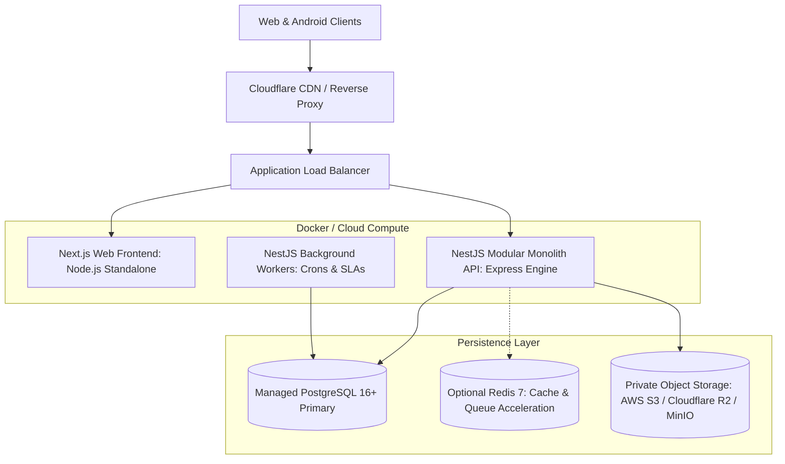

# EarnXpress — Deployment, Infrastructure & DevOps Specification

| Metadata | Details |
| :--- | :--- |
| **Document Version** | 1.1.0-AUDITED |
| **Project Code** | EX-DEVOPS |
| **Document Status** | Approved for Development Foundation |
| **Classification** | Master Infrastructure Specification |
| **Last Updated** | 2026-11-03 |
| **Deployment Model** | Modular Monolith Containerized Deployment |

---

## 1. Production Topology & Architectural Decisions



### 1.1 Architectural Evaluation: Express vs. Fastify for NestJS
- **Decision**: **Express** is selected as the standard HTTP engine for NestJS in Phase 1.
- **Rationale**: While Fastify offers high raw synthetic throughput, Express provides 100% stable compatibility with all NestJS decorators, Swagger OpenAPI generation, Passport session cookies, and standard multipart upload libraries without edge-case incompatibilities.

### 1.2 Evaluation of Optional Services (Redis & MinIO)
- **Redis (Optional)**:
  - In MVP / Development, scheduled jobs (72h review reminders, start timeouts) can execute using NestJS native `@nestjs/schedule` (in-process cron backed by PostgreSQL timestamp queries).
  - Redis can be connected optionally for high-throughput distributed queues (BullMQ) and token-bucket rate limiting without modifying domain code.
- **MinIO / Private Object Storage (Optional)**:
  - For local development, files can be stored using local disk storage or local MinIO containers.
  - In cloud staging/production, the application connects directly to AWS S3 or Cloudflare R2 via standard S3 SDK pre-signed URLs.

---

## 2. Local Development Environment (`docker-compose.yml`)

The repository includes a lean `docker-compose.yml` to spin up local development persistence:

```yaml
version: '3.8'

services:
  postgres:
    image: postgres:16-alpine
    container_name: earnxpress-postgres
    restart: unless-stopped
    environment:
      POSTGRES_USER: earnxpress_admin
      POSTGRES_PASSWORD: earnxpress_dev_secret
      POSTGRES_DB: earnxpress_db
    ports:
      - "5432:5432"
    volumes:
      - postgres_data:/var/lib/postgresql/data
    healthcheck:
      test: ["CMD-SHELL", "pg_isready -U earnxpress_admin -d earnxpress_db"]
      interval: 5s
      timeout: 5s
      retries: 5

  # Optional Redis service for queue acceleration
  redis:
    image: redis:7-alpine
    container_name: earnxpress-redis
    restart: unless-stopped
    ports:
      - "6379:6379"
    volumes:
      - redis_data:/data

volumes:
  postgres_data:
  redis_data:
```

---

## 3. Database Migration & High Availability

1. **Prisma Migrate Strategy**:
   - Schema migrations execute in CI/CD pipeline via `prisma migrate deploy` prior to application container deployment.
   - Zero-downtime expand-and-contract migrations prevent database locking during rollouts.
2. **Backup & Disaster Recovery**:
   - **Continuous WAL Archiving**: Point-In-Time-Recovery (PITR) up to 7 days.
   - **Daily Automated Snapshots**: Taken at 02:00 UTC, retained for 30 days.
   - **RPO / RTO**: RPO $\le 5\text{ minutes}$; RTO $\le 30\text{ minutes}$.

---

## 4. Observability & Health Probes

- `GET /health/live`: Fast liveness check returning `HTTP 200` if event loop is healthy.
- `GET /health/ready`: Readiness check verifying PostgreSQL database pool connectivity.
- Structured JSON logging using **Pino** logger with fields: `level`, `time`, `context`, `userId`, `traceId`.
