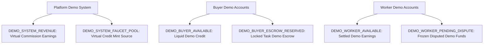

# EarnXpress — Simulated Financial Engine & Demo Ledger Specification

| Metadata | Details |
| :--- | :--- |
| **Document Version** | 1.1.0-AUDITED |
| **Project Code** | EX-FIN |
| **Document Status** | Approved for Development Foundation |
| **Classification** | Master Financial Simulation Specification |
| **Last Updated** | 2026-11-03 |
| **Currency Invariant** | Virtual United States Dollar (USD), tracked in integer cents |

---

## 1. Principles of Virtual Simulation

The EarnXpress MVP operates **STRICTLY ON DEMO FINANCIAL SIMULATION**:
- **Absolute Prohibition**: Zero real money, zero real escrow, zero real payment gateways (Stripe, PayPal, bKash), zero real bank transfers, and zero cryptocurrency transactions.
- **Explicit Demo Branding**: Every balance display, transaction history entry, receipt, invoice preview, and system notification must be prominently labeled with **DEMO** (e.g. `DEMO $100.00 USD`).
- **Mathematical Invariant**: Double-entry ledger architecture where every transaction consists of balanced debits and credits:
  $$\sum \text{Debits} - \sum \text{Credits} = 0$$
- **Integer Cents Precision**: All monetary calculations operate on 64-bit integers (`BIGINT` in PostgreSQL / `bigint` in TypeScript). Floating-point arithmetic (`FLOAT`, `DOUBLE`) is prohibited in financial logic.

---

## 2. Chart of Demo Accounts



| Account Identifier | Type | Normal Balance | Purpose |
| :--- | :--- | :--- | :--- |
| `DEMO_SYSTEM_FAUCET_POOL` | Equity / Mint | Credit | Virtual source from which demo balances are injected into user accounts. |
| `DEMO_SYSTEM_REVENUE` | Revenue | Credit | Accumulates simulated platform commission earnings. |
| `DEMO_BUYER_AVAILABLE` | Liability | Credit | Unencumbered virtual credit available for task publishing. |
| `DEMO_BUYER_ESCROW_RESERVED` | Liability | Credit | Demo funds locked against active task capacity. |
| `DEMO_WORKER_AVAILABLE` | Liability | Credit | Settled virtual earnings belonging to the Worker. |
| `DEMO_WORKER_PENDING_DISPUTE`| Liability | Credit | Disputed demo funds frozen pending arbitration. |

---

## 3. Commission Calculator & Mathematical Formulas

### 3.1 Proposed Commission Structure `[PROPOSED]`
- **Buyer Platform Surcharge ($F_B$)**: **2.0%** added to the gross task budget.
- **Worker Platform Commission ($F_W$)**: **4.0%** deducted from the gross task payout upon approval.
- **Platform Total Margin**: **6.0%** of gross task budget.
- **Status Note**: This commission schedule is `[PROPOSED]` and requires Platform Owner executive sign-off before production activation.

#### Calculation Example: \$100.00 Unit Task (10,000 cents):
1. Gross Task Budget per Slot ($B$): $10,000\text{ cents}$ (DEMO \$100.00).
2. Buyer Fee ($F_B$): $\text{round}(10,000 \times 0.02) = 200\text{ cents}$ (DEMO \$2.00).
3. Total Demo Escrow Reserved ($E$): $B + F_B = 10,200\text{ cents}$ (DEMO \$102.00).
4. Worker Standard Commission ($F_W$): $\text{round}(10,000 \times 0.04) = 400\text{ cents}$ (DEMO \$4.00).
5. Net Worker Demo Payout ($P_W$): $B - F_W = 9,600\text{ cents}$ (DEMO \$96.00).
6. Platform Gross Revenue ($R_{\text{Platform}}$): $F_B + F_W = 600\text{ cents}$ (DEMO \$6.00).

### 3.2 Proposed Consecutive Failure Surcharge `[PROPOSED] [LEGAL REVIEW REQUIRED]`
- **Trigger**: Three (3) consecutive objectively verified failures (adjudicated by staff, not merely unapproved submissions).
- **Surcharge**: One-time extra 2.0% deducted from the Worker's next successfully approved task (Total fee = $4.0\% + 2.0\% = 6.0\%$).
- **Strict Non-Compounding Rule**:
  - The penalty **never compounds** beyond 2.0% (no 8%, 10%, etc.).
  - Surcharge resets to zero upon successful task completion.
  - Subsequent failures trigger staff review, slot caps, or probation rather than further monetary deductions.
- **Legal Review Invariant**: Must be reviewed by qualified legal counsel in target markets before any live financial activation.

---

## 4. Double-Entry Journal Scenarios

### 4.1 Scenario 1: Buyer Injects \$1,000.00 Demo Faucet Balance
```text
Transaction: DEMO_FAUCET_INJECTION (Amount: 100,000 cents)
  DEBIT   DEMO_SYSTEM_FAUCET_POOL     100,000 cents
  CREDIT  DEMO_BUYER_AVAILABLE        100,000 cents
```

### 4.2 Scenario 2: Buyer Publishes 50-Slot Task (\$10.00 each = 1,000 cents/slot)
- Total Task Budget: $50 \times 1,000 = 50,000\text{ cents}$ (DEMO \$500.00).
- Buyer Surcharge (2%): $1,000\text{ cents}$ (DEMO \$10.00).
- Total Demo Escrow Required: $51,000\text{ cents}$ (DEMO \$510.00).
```text
Transaction: DEMO_TASK_ESCROW_LOCK (Amount: 51,000 cents)
  DEBIT   DEMO_BUYER_AVAILABLE        51,000 cents
  CREDIT  DEMO_BUYER_ESCROW_RESERVED  51,000 cents
```

### 4.3 Scenario 3: Single Worker Approved & Settled (\$10.00 slot = 1,000 cents)
- Slot Escrow Share: $1,000 + 20 (\text{Buyer Fee}) = 1,020\text{ cents}$.
- Worker Net (96%): $960\text{ cents}$ (DEMO \$9.60).
- Worker Commission (4%): $40\text{ cents}$ (DEMO \$0.40).
- Buyer Platform Fee (2%): $20\text{ cents}$ (DEMO \$0.20).
```text
Transaction: DEMO_SLOT_PAYOUT (Amount: 1,020 cents)
  DEBIT   DEMO_BUYER_ESCROW_RESERVED  1,020 cents
  CREDIT  DEMO_WORKER_AVAILABLE         960 cents
  CREDIT  DEMO_SYSTEM_REVENUE            60 cents  (40 worker fee + 20 buyer fee)
```

### 4.4 Scenario 4: Buyer Closes 20 Unclaimed Slots
- 20 slots $\times 1,020\text{ cents/slot} = 20,400\text{ cents}$ (DEMO \$204.00) returned to Buyer:
```text
Transaction: DEMO_SLOT_CLOSURE_REFUND (Amount: 20,400 cents)
  DEBIT   DEMO_BUYER_ESCROW_RESERVED  20,400 cents
  CREDIT  DEMO_BUYER_AVAILABLE        20,400 cents
```

---

## 5. Local Currency Indicative Display & Exchange-Rate Snapshots

- All ledger balances and calculations are executed exclusively in USD integer cents.
- For international usability, the UI renders indicative local conversions using timestamped FX snapshots:
  ```typescript
  interface FxSnapshot {
    baseCurrency: 'USD';
    rates: {
      BDT: 121.50; // Bangladeshi Taka
      EUR: 0.92;   // Euro
      GBP: 0.79;   // British Pound
      INR: 84.20;  // Indian Rupee
    };
    snapshotTimestamp: '2026-11-03T20:00:00.000Z';
  }
  ```
- **Historical Invariant**: Historical transactions record the USD cents and the FX snapshot rate active at the moment of execution; historical records are never retroactively modified when FX rates fluctuate.
