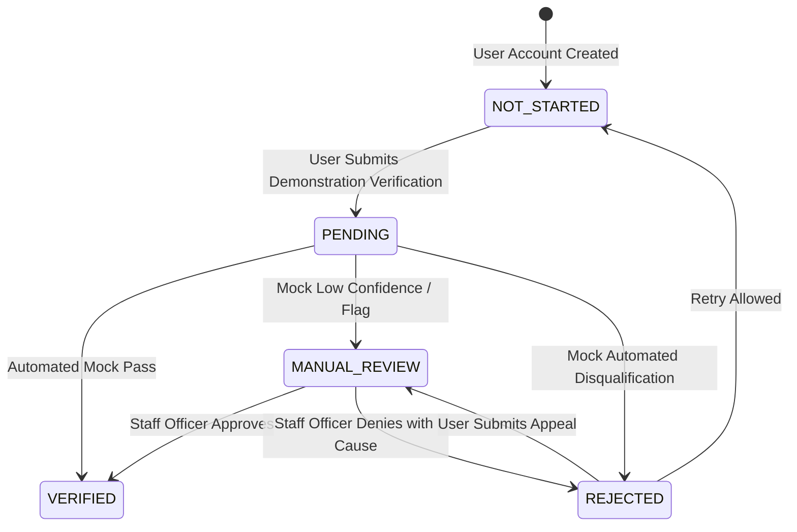

# EarnXpress — Identity Verification Architecture & Privacy Specification

| Metadata | Details |
| :--- | :--- |
| **Document Version** | 1.1.0-AUDITED |
| **Project Code** | EX-IDV |
| **Document Status** | Approved for Development Foundation |
| **Classification** | Master Identity Architecture Specification |
| **Last Updated** | 2026-11-03 |

---

## 1. Architectural Philosophy: Provider Adapter Pattern

EarnXpress implements an international, country-independent identity verification architecture structured around the **Provider Adapter Pattern**. The system decouples the core user profile from any specific KYC vendor:

```mermaid
graph TD
    Client[Web / Android Client] --> API[NestJS Identity Module]
    API --> Adapter[<<interface>> IdentityVerificationProvider]
    Adapter --> Mock[MockVerificationProvider (MVP / Dev)]
    Adapter -.-> Sumsub[SumsubProvider (Future Phase)]
    Adapter -.-> Veriff[VeriffProvider (Future Phase)]
    
    API --> DB[(Demo Verification Store)]
    API --> AdminQueue[Staff Manual Review Queue]
```

### 1.1 Strict MVP Privacy Boundaries `[CONFIRMED]`
- **Zero Real Documents**: The MVP strictly **does NOT** collect, store, or process real government-issued identity documents, national ID cards, driver's licenses, or passports.
- **Zero Biometrics**: The MVP strictly **does NOT** collect or generate real biometric templates, facial vector maps, or liveness video scans.
- **Mock Verification Demonstration**:
  - Demonstration UI allows users to test the multi-step verification experience using synthetic sample data.
  - Pluggable `MockVerificationProvider` handles verification state transitions predictably.
  - Stored records contain only synthetic reference IDs and demo verification statuses.
- **No Absolute Fraud Claim**: The platform explicitly disclaims that identity verification guarantees complete fraud prevention; it forms one layer in a defense-in-depth trust architecture.

---

## 2. Verification States & Lifecycle



| State | User Tier Privileges | Description |
| :--- | :--- | :--- |
| `NOT_STARTED` | Standard: Browse, accept standard tasks, claim demo faucet. | Baseline state for all newly registered accounts. |
| `PENDING` | Standard: In-flight verification review. | Verification payload transmitted to adapter. Awaiting response. |
| `VERIFIED` | Full: Verified badge displayed, priority placement. | Identity confirmed. Biometric match score $\ge 90\%$ (simulated). |
| `MANUAL_REVIEW` | Standard: Held for human evaluation. | Inconclusive signals (e.g. blurry image, transliteration mismatch). |
| `REJECTED` | Restricted: Blocked from accepting new slots until resolved. | Falsified submission, underage applicant, or duplicate identity. |

---

## 3. Country-Independent Document Taxonomy

The architecture defines a generalized, country-independent document categorization schema:

| Generic Document Category | Regional Implementation Examples | Standard Validation Format |
| :--- | :--- | :--- |
| **National Identity Card** | Bangladesh Smart NID / Old NID, EU National ID Card, Indian Voter ID | Numeric/alphanumeric regex check; country checksum. |
| **Passport** | International Machine-Readable Passport (MRP) | ICAO 9303 standard 2-line Machine Readable Zone (MRZ). |
| **Driver's License** | US State Driver's License, UK / EU Photocard License | Jurisdictional format validation. |

---

## 4. Fraud Risk Detection Architecture (Future Production Design) `[DEFERRED]`

To prevent multi-accounting, bonus abuse, and bad-actor recidivism in post-MVP phases:
1. **Deterministic Identity Hash (`identity_dedup_hash`)**:
   $$\text{Hash} = \text{SHA256}(\text{ISO\_Country} \mathbin{\Vert} \text{Normalized\_Doc\_Number} \mathbin{\Vert} \text{Date\_Of\_Birth})$$
   Enforced via PostgreSQL unique index to prevent duplicate accounts per government ID.
2. **Device Telemetry & IP Geolocation**: Flags anomalies where client IP geolocation differs substantially from document issuing jurisdiction without proxy or residency explanations.

---

## 5. NestJS Provider Interface Contract

```typescript
export interface IdentityVerificationPayload {
  userId: string;
  countryCode: string; // ISO-3166-1 alpha-2
  documentType: 'PASSPORT' | 'NATIONAL_ID' | 'DRIVING_LICENSE';
  documentNumberMasked: string; // e.g. "••••••••1234"
  demoDocumentFrontUrl: string;
  demoSelfieUrl: string;
  ipAddress: string;
  userAgent: string;
}

export interface VerificationResult {
  status: 'VERIFIED' | 'MANUAL_REVIEW' | 'REJECTED';
  providerReferenceId: string;
  confidenceScore: number; // 0 to 100
  riskFlags: string[];
  rejectionReason?: string;
}

export interface IdentityVerificationProvider {
  submitVerification(payload: IdentityVerificationPayload): Promise<VerificationResult>;
  checkStatus(referenceId: string): Promise<VerificationResult>;
}
```

### 5.1 Deterministic Mock Provider (MVP Implementation)
For automated testing and user demonstrations:
- Document number ending in `000` $\implies$ `VERIFIED` (Confidence: 98).
- Document number ending in `111` $\implies$ `MANUAL_REVIEW` (Flag: `MOCK_IMAGE_BLURRY`).
- Document number ending in `999` $\implies$ `REJECTED` (Reason: `MOCK_DOCUMENT_EXPIRED`).
- All other inputs $\implies$ `PENDING`, transitioning to `VERIFIED` via background worker.
