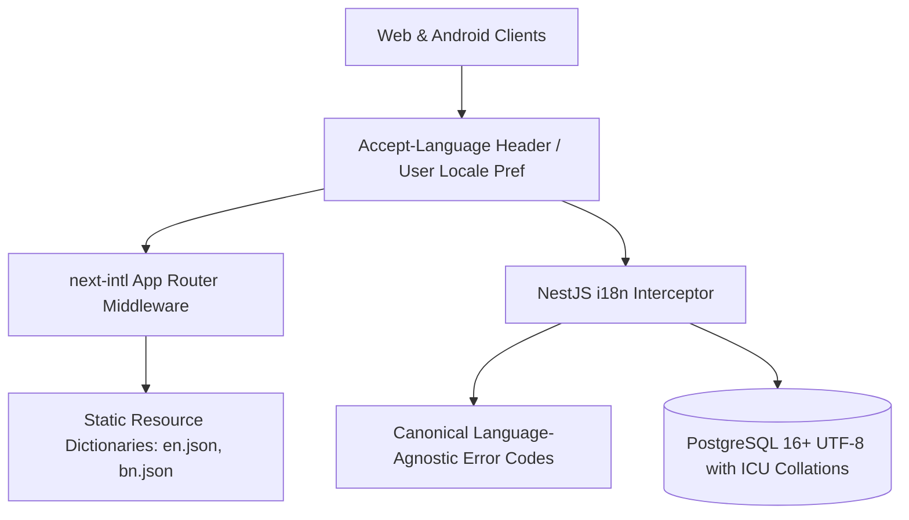

# EarnXpress — Internationalization (i18n) & Localization (l10n) Specification

| Metadata | Details |
| :--- | :--- |
| **Document Version** | 1.1.0-AUDITED |
| **Project Code** | EX-I18N |
| **Document Status** | Approved for Development Foundation |
| **Classification** | Master Internationalization Specification |
| **Last Updated** | 2026-11-03 |
| **Launch Language** | English (`en-US`) |
| **Priority Expansion**| Bangla (`bn-BD`) |

---

## 1. Architectural Philosophy: i18n-First Design

EarnXpress launches in English (`en-US`), but the system is engineered so that adding Bangla (`bn-BD`) or any future international language requires **zero database schema redesign and zero application refactoring**.

---

## 2. Content Translation vs. Original Integrity

### 2.1 Preserving Original Task Instructions
- **Strict Invariant**: User-authored task instructions, acceptance criteria, and deliverable notes are stored **in their original language** as entered by the Buyer or Worker.
- The original text is never overwritten by automated translation.

### 2.2 Distinguishing Translated Content in the UI
- When automated translation is enabled on the client:
  - Translated task content is accompanied by a prominent badge:  
    `Translated from English (Show Original)` / `মূল ইংরেজি থেকে অনূদিত (আসল দেখুন)`.
  - A one-click toggle allows the Worker or Buyer to view the original text side-by-side.

---

## 3. Currency & Financial Display Architecture

- **USD Reference Invariant**: All internal balances, ledger transactions, and commission math are calculated and recorded exclusively in **USD integer cents**.
- **Local Currency Display**: The UI renders indicative local conversions (e.g. Bangladeshi Taka `BDT`, Euro `EUR`) using timestamped FX snapshots:
  $$\text{Indicative BDT} = \frac{\text{Amount in Cents}}{100} \times 121.50$$
- **Historical Immutability**: Historical financial records store the exact USD cents and FX snapshot rate active at the moment of settlement. Historical records are never retroactively modified when current exchange rates change.

---

## 4. Timezones & Deadlines

- **UTC Storage Invariant**: All timestamps in PostgreSQL use `TIMESTAMPTZ` (UTC).
- **User-Local Rendering**: Frontends (Web and Android) convert timestamps to the user's device timezone using the native `Intl.DateTimeFormat`:
  - English: `Nov 3, 2026, 8:15 PM (UTC+6)`
  - Bangla: `৩ নভেম্বর, ২০২৬, রাত ৮:১৫`
- **Preserving Task Deadlines**: Server-enforced start deadlines (`startDeadlineAt`) and submission deadlines (`executionDeadlineAt`) are computed against server UTC time. Countdown timers render relative time (e.g., `5h 42m remaining`) regardless of client clock skew.

---

## 5. Sample Core Marketplace Dictionary (English vs. Bangla)

| Translation Key | English (`en-US`) | Bangla (`bn-BD`) |
| :--- | :--- | :--- |
| `brand.name` | EarnXpress | আর্নএক্সপ্রেস |
| `tasks.capacity` | Worker Capacity | কর্মী ধারণক্ষমতা |
| `tasks.availableSlots` | Remaining Available Slots | অবশিষ্ট খালি স্লট |
| `tasks.inProgress` | Currently Working | বর্তমানে কর্মরত |
| `tasks.acceptSlot` | Accept Task Slot | কাজের স্লট গ্রহণ করুন |
| `tasks.submitDeliverable`| Submit Deliverables | কাজের প্রমাণ জমা দিন |
| `tasks.reviewOverdue` | Review Overdue (Under Staff Review) | পর্যালোচনা বিলম্বিত (পর্যালোচনাধীন) |
| `tasks.model.multiWorker` | Multi-Worker Task | বহু-কর্মী কাজ |
| `tasks.model.firstApproved`| First Approved Bounty | প্রথম অনুমোদিত বাউন্টি |
| `finance.demoWallet` | Demo Wallet | ডেমো ওয়ালেট |
| `finance.demoBalance` | Available Demo Balance | ব্যবহারযোগ্য ডেমো ব্যালেন্স |
| `finance.faucetClaim` | Claim \$1,000 Demo Credit | \$১,০০০ ডেমো ক্রেডিট গ্রহণ করুন |
