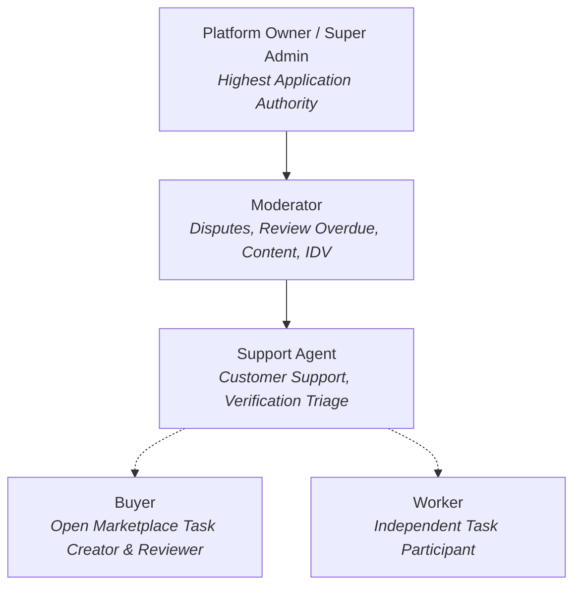

# EarnXpress — Role-Based & Attribute-Based Permission Matrix (RBAC & ABAC)

| Metadata | Details |
| :--- | :--- |
| **Document Version** | 1.1.0-AUDITED |
| **Project Code** | EX-PERM |
| **Document Status** | Approved for Development Foundation |
| **Classification** | Master Authorization Specification |
| **Last Updated** | 2026-11-03 |

---

## 1. Role Taxonomy & Authority Guardrails

### 1.1 Application Authority vs. Infrastructure Ownership
- **Application-Level Authority (Platform Owner)**: Governs user roles, marketplace fees, disputes, content moderation, and global application parameters inside the database.
- **Infrastructure Ownership**: Cloud hosting accounts, VPS root SSH keys, database superuser credentials, and DNS records are separate operational layers governed by infrastructure access policies. Application administrators do not possess server root access by default.

---

## 2. Comprehensive RBAC Matrix

**Legend**:
- $\checkmark$ : Fully Permitted
- $\circ$ : Permitted with Ownership / Context Constraint (ABAC)
- $\times$ : Forbidden / Denied

| Operational Capability | Worker | Buyer | Support Agent | Moderator | Platform Owner |
| :--- | :---: | :---: | :---: | :---: | :---: |
| **Authentication & Account** | | | | | |
| Register, Login, Reset Password | $\checkmark$ | $\checkmark$ | $\checkmark$ | $\checkmark$ | $\checkmark$ |
| Enable / Disable TOTP MFA | $\checkmark$ | $\checkmark$ | $\checkmark$ (Mandatory) | $\checkmark$ (Mandatory) | $\checkmark$ (Mandatory) |
| Re-authenticate for Sensitive Operations | $\checkmark$ | $\checkmark$ | $\checkmark$ | $\checkmark$ | $\checkmark$ |
| Edit Own Profile & Skills | $\checkmark$ | $\checkmark$ | $\checkmark$ | $\checkmark$ | $\checkmark$ |
| View Public User Profiles | $\checkmark$ | $\checkmark$ | $\checkmark$ | $\checkmark$ | $\checkmark$ |
| **Open Marketplace Task Management** | | | | | |
| Browse & Search Tasks | $\checkmark$ | $\checkmark$ | $\checkmark$ | $\checkmark$ | $\checkmark$ |
| View Public Aggregate Participation Stats | $\checkmark$ | $\checkmark$ | $\checkmark$ | $\checkmark$ | $\checkmark$ |
| Post Public Q&A Clarifying Questions | $\checkmark$ | $\checkmark$ | $\checkmark$ | $\checkmark$ | $\checkmark$ |
| Answer Public Q&A on Task | $\times$ | $\circ$ (Task Buyer)| $\times$ | $\checkmark$ | $\checkmark$ |
| Create Task via 5-Step Wizard | $\times$ | $\checkmark$ | $\times$ | $\times$ | $\checkmark$ |
| Publish Task & Lock Demo Escrow | $\times$ | $\checkmark$ | $\times$ | $\times$ | $\checkmark$ |
| Pause / Resume Task Acceptance | $\times$ | $\circ$ (Task Buyer)| $\times$ | $\times$ | $\checkmark$ |
| Close Remaining Unclaimed Slots | $\times$ | $\circ$ (Task Buyer)| $\times$ | $\times$ | $\checkmark$ |
| Cancel Task Campaign | $\times$ | $\circ$ (Task Buyer)| $\times$ | $\circ$ (Policy Case) | $\checkmark$ |
| **Worker Participation & Execution** | | | | | |
| Accept Task Slot (Atomic Binding) | $\checkmark$ | $\times$ | $\times$ | $\times$ | $\times$ |
| View Confidential Task Instructions | $\circ$ (Assigned) | $\circ$ (Task Buyer)| $\times$ | $\checkmark$ | $\checkmark$ |
| Submit Milestone Evidence | $\circ$ (Assigned) | $\times$ | $\times$ | $\times$ | $\times$ |
| Verify Milestone Progress (Updates %) | $\times$ | $\circ$ (Task Buyer)| $\times$ | $\checkmark$ | $\checkmark$ |
| Submit Final Deliverable Evidence | $\circ$ (Assigned) | $\times$ | $\times$ | $\times$ | $\times$ |
| View Individual Progress of Other Workers | $\times$ | $\circ$ (Task Buyer)| $\times$ | $\checkmark$ | $\checkmark$ |
| **Review, Overdue & Disputes** | | | | | |
| Approve Deliverables & Release Demo Funds| $\times$ | $\circ$ (Task Buyer)| $\times$ | $\circ$ (Overdue Case)| $\checkmark$ |
| Request Revision (Within Quota) | $\times$ | $\circ$ (Task Buyer)| $\times$ | $\times$ | $\times$ |
| Reject Submission (With Grounds) | $\times$ | $\circ$ (Task Buyer)| $\times$ | $\times$ | $\times$ |
| Review `REVIEW_OVERDUE` Submissions | $\times$ | $\circ$ (Grace Only)| $\times$ | $\checkmark$ | $\checkmark$ |
| Arbitrate & Split Disputed Escrow | $\times$ | $\times$ | $\times$ | $\checkmark$ | $\checkmark$ |
| Override Moderator Dispute Verdict | $\times$ | $\times$ | $\times$ | $\times$ | $\checkmark$ (Owner Only) |
| **Demo Financial Ledger** | | | | | |
| View Own Demo Balances & History | $\checkmark$ | $\checkmark$ | $\checkmark$ | $\checkmark$ | $\checkmark$ |
| Claim Demo Faucet Credit (\$1,000) | $\checkmark$ | $\checkmark$ | $\times$ | $\times$ | $\checkmark$ |
| Inspect Global Platform Ledger | $\times$ | $\times$ | $\times$ | $\times$ | $\checkmark$ (Owner Only) |
| Modify Commission Percentages | $\times$ | $\times$ | $\times$ | $\times$ | $\checkmark$ (Owner Only) |
| **User Administration & Moderation** | | | | | |
| View User Directory & Verification Status| $\times$ | $\times$ | $\checkmark$ | $\checkmark$ | $\checkmark$ |
| Issue Policy Warning / Restrict Slots | $\times$ | $\times$ | $\checkmark$ | $\checkmark$ | $\checkmark$ |
| Suspend / Permanently Ban User | $\times$ | $\times$ | $\times$ | $\checkmark$ | $\checkmark$ |
| Assign Moderator / Support Roles | $\times$ | $\times$ | $\times$ | $\times$ | $\checkmark$ (Owner Only) |
| Transfer Platform Root Ownership | $\times$ | $\times$ | $\times$ | $\times$ | $\checkmark$ (Owner Only) |
| **Audit Trails & System Configuration** | | | | | |
| View Immutable Audit Log | $\times$ | $\times$ | $\times$ | $\checkmark$ | $\checkmark$ |
| Modify / Delete Audit Log Records | $\times$ (BLOCKED) | $\times$ (BLOCKED) | $\times$ (BLOCKED) | $\times$ (BLOCKED) | $\times$ (TRIGGER BLOCKS ALL) |

---

## 3. Attribute-Based Access Control (ABAC) Invariants

1. **Direct Task Authorship Invariant**:
   A Buyer may only pause, resume, close remaining slots, verify milestones, or review submissions for tasks where:
   $$\text{task.buyerId} == \text{currentUser.id}$$
2. **Worker Participation Isolation Invariant**:
   A Worker may only view their own confidential deliverable attachments, submit milestone proofs, or respond to revision requests for records where:
   $$\text{participation.workerId} == \text{currentUser.id}$$
3. **Privacy Invariant on Progress Tracking**:
   - Public users and other participating workers can only view aggregate dashboard numbers (Total slots, available, working, approved).
   - Only the Task Buyer, the assigned Worker themselves, and authorized Staff can view individual Worker deliverable files and milestone checklists.
4. **Platform Owner Non-Escalation Guarantee**:
   Any HTTP mutation attempting to update a user's role to `SUPER_ADMIN`, `MODERATOR`, or `SUPPORT_AGENT` is rejected with `HTTP 403 Forbidden` unless the authenticated session belongs to the `PLATFORM_OWNER` with verified MFA and recent re-authentication.
