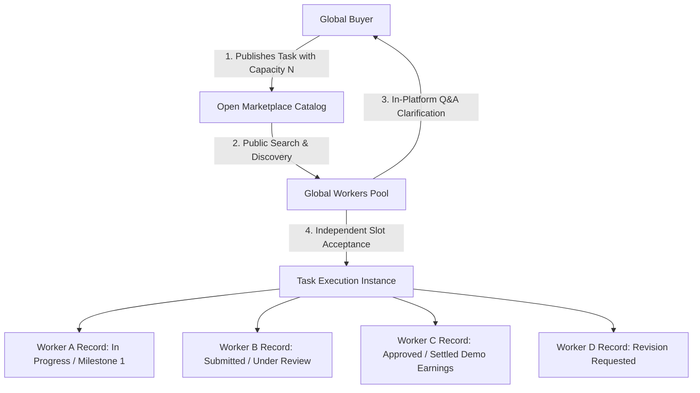
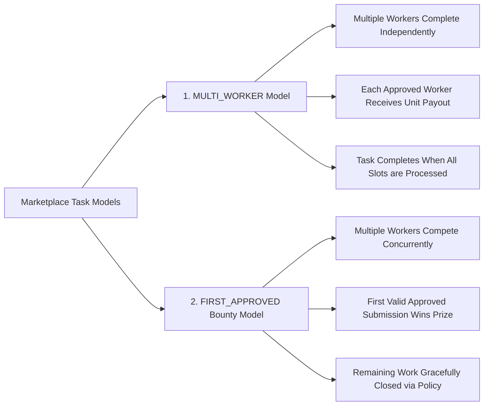
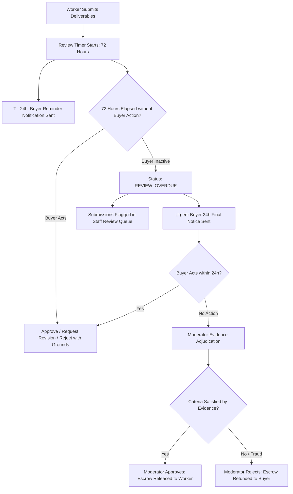

# EarnXpress — Product Requirements Document (PRD)

| Metadata | Details |
| :--- | :--- |
| **Document Version** | 1.1.0-AUDITED |
| **Project Code** | EX-CORE |
| **Document Status** | Approved for Development Foundation |
| **Classification** | Master Requirements Specification |
| **Last Updated** | 2026-11-03 |
| **Target Initial Release**| English Responsive Web (Next.js) |
| **Subsequent Milestones**| Multi-language Support (Bangla first), Android Application (Kotlin/Jetpack Compose) |

---

## 1. Executive Summary & Core Product Philosophy

**EarnXpress** is an **OPEN INTERNATIONAL TASK MARKETPLACE** connecting global Buyers (individuals, businesses, project creators) and distributed Workers (freelancers, technical contributors, and micro-task operators).

The platform is explicitly **NOT** a conventional 1:1 direct freelancing board where one Buyer only hires one Worker after off-platform interviews. EarnXpress is an open, high-capacity, multi-participant execution exchange where:
- Any registered Buyer can publish tasks with configurable Worker capacity.
- Any registered Worker can discover and accept available task slots without prior personal relationships, pre-existing reputation networks, or off-platform negotiation.
- Tasks support hundreds or thousands of simultaneous Workers executing identical or competitive specifications with completely independent work records.
- All inquiries, clarifications, instructions, evidence submissions, reviews, and dispute arbitrations take place strictly inside the platform.

---

## 2. Open Marketplace Foundations

### 2.1 Frictionless Discovery & Participation
- **Zero Gatekeeping**: A newly registered Worker in Bangladesh, Kenya, or Germany can discover an open task, read complete instructions, inspect measurable acceptance criteria, ask clarifying questions in the task thread, accept a slot, and begin work immediately.
- **In-Platform Communication**: Task-scoped public question threads allow Workers to request instruction clarification before accepting. Private communication channels support Worker-Buyer queries during execution.
- **Complete Upfront Transparency**: Instructions, required tools, file formats, unit demo compensation, start deadlines, execution deadlines, and objective acceptance checklists must be 100% visible prior to slot acceptance.

---

## 3. Multiple Workers Per Task Architecture

When a task's operational model permits multiple participants, EarnXpress treats every participating Worker as an autonomous, decoupled entity:

### 3.1 Independent Work Records (`WorkerParticipation`)
Every accepted Worker receives an isolated `WorkerParticipation` record containing:
1. **Individual Status**: Worker A can be `APPROVED` while Worker B is `REVISION_REQUESTED` and Worker C is `IN_PROGRESS`.
2. **Individual Progress**: Derived strictly from verified deliverables and milestone evidence, never self-reported percentages.
3. **Individual Deadlines**: Timestamped countdowns for task start, execution, and submission.
4. **Individual Submissions**: Independent file uploads, URLs, and text notes versioned per submission.
5. **Individual Reviews**: Buyer reviews, approves, requests revisions on, or rejects each Worker's submission independently.
6. **Individual Simulated Earnings**: Approved Workers receive simulated demo payouts immediately upon approval, regardless of whether other slots are still working.

### 3.2 Failure & Completion Isolation
- **Failure Isolation**: One Worker's abandonment, rejection, or dispute has **zero effect** on other participating Workers.
- **Completion Isolation**: One Worker's approval does **not** close or complete the parent task (unless running under the `FIRST_APPROVED` bounty model).

---

## 4. Supported Task Operational Models

EarnXpress natively supports two distinct marketplace task models:

### 4.1 Model 1: `MULTI_WORKER` (Independent Multi-Participant Execution) `[CONFIRMED]`
- **Concept**: A Buyer publishes a task requiring $N$ independent completions (e.g., 100 website usability reviews, 500 image labeling tasks, 50 localized translations).
- **Execution**:
  - Up to $N$ eligible Workers accept individual slots.
  - Each Worker submits evidence independently.
  - Buyer reviews each submission against the objective criteria checklist.
  - Each approved Worker receives the unit demo payout.
  - The task transitions to `FULL` when all slots are accepted, and `COMPLETED` when all accepted submissions reach terminal settlement (`APPROVED`, `REJECTED`, or `DISPUTED`).

### 4.2 Model 2: `FIRST_APPROVED` (Competitive Bounty Race) `[CONFIRMED]`
- **Concept**: A Buyer publishes a critical problem or urgent creative bounty with a fixed prize pool (e.g., reproduce a complex bug, solve an optimization challenge).
- **Execution**:
  - Multiple eligible Workers accept slots and work concurrently.
  - Workers submit deliverables as soon as ready.
  - **First to Satisfy Criteria Wins**: Submissions are reviewed in order of submission. The first submission that satisfies all acceptance criteria and receives valid approval is awarded the prize.
  - **Submission Time Does Not Guarantee Payment**: Submitting first does not win if the submission fails criteria.
  - **Remaining Participant Closure Policy**:
    - The instant a winning submission is approved, the task status changes to `CLOSED`.
    - All remaining `IN_PROGRESS` or `SUBMITTED` participations are closed gracefully with status `FIRST_APPROVED_CLOSED`.
    - Workers in progress receive an automated notification and retain a verified platform activity entry on their profile.
    - If a Worker had submitted verifiable partial work before closure, the Buyer may optionally award discretionary demo appreciation bonuses.

---

## 5. Task Participation Dashboard & Progress Metrics

Every task details page renders a real-time, high-density **Task Participation Dashboard**:

### 5.1 Public Aggregate Metrics (Visible to All Marketplace Users)
- **Total Capacity ($N$)**: Total slots configured by Buyer (e.g., `100 slots`).
- **Accepted Slots**: Total workers who have claimed a slot (e.g., `50`).
- **Currently Working**: Total slots actively in progress (e.g., `35`).
- **Submitted for Review**: Deliverables pending review (e.g., `8`).
- **Approved**: Successfully completed and settled slots (e.g., `5`).
- **Rejected / Terminated**: Unapproved or timed-out slots (e.g., `2`).
- **Remaining Available Slots**: Unclaimed slots open for new Workers (e.g., `50`).

### 5.2 Individual Progress Tracking (Authorized Access Only)
- **Access Control**: Visible only to the Task Buyer, the assigned Worker themselves, and Platform Staff (Moderators/Owner).
- **Meaningful Progress Calculation**:
  $$\text{Progress \%} = \frac{\text{Completed Verified Milestones}}{\text{Total Required Task Milestones}} \times 100$$
  - **Strict Policy**: Progress percentages are derived **strictly from verifiable deliverable checkpoints** (e.g., Step 1: Draft outline submitted $\to 33\%$; Step 2: Code repository linked $\to 66\%$; Step 3: Test suite attached $\to 100\%$).
  - **Self-Reported Percentages Prohibited**: Workers cannot type or slide a self-declared progress bar without attaching milestone proof.

---

## 6. Configurable Capacity & Task Management Controls

Buyers possess flexible administrative controls over published tasks:

| Action | Permitted Task States | System Behavior & Invariants |
| :--- | :--- | :--- |
| **`PAUSE_TASK`** | `OPEN`, `IN_PROGRESS` | Temporarily freezes new slot reservations. Currently accepted Workers continue working unaffected. |
| **`RESUME_TASK`** | `PAUSED` | Reopens remaining unclaimed slots to the open marketplace. |
| **`CLOSE_REMAINING_SLOTS`**| `OPEN`, `PAUSED` | Permanently closes all unclaimed slots. Unused reserved Demo Balance is immediately refunded to Buyer. Already accepted Workers finish their work. |
| **`CANCEL_TASK`** | `OPEN`, `PAUSED`, `IN_PROGRESS` | Terminates task. Unclaimed escrow refunded immediately. Active workers evaluated based on verified milestone evidence; partial demo compensation awarded where warranted. |

---

## 7. Review SLA & The 72-Hour `REVIEW_OVERDUE` Escalation Policy

EarnXpress replaces naive auto-approval with an objective, structured escalation model:

### 7.1 Inactivity Does Not Establish Validity
- Under no circumstances does Buyer inactivity automatically guarantee that a submission is valid or bug-free.
- Automatically releasing funds to non-compliant or malicious submissions harms Buyer trust; stranding Workers indefinitely harms Worker trust.

### 7.2 Structured Escalation Sequence
1. **0 to 72 Hours (Standard Review Window)**: Buyer reviews evidence, issues revisions, or approves payout.
2. **Hour 48**: Automated reminder notification dispatched to Buyer.
3. **Hour 72 (Overdue Transition)**:
   - Submission status transitions to `REVIEW_OVERDUE`.
   - Buyer receives high-priority email and in-app alert with a final 24-hour response window.
   - Submission enters the **Platform Moderation Priority Triage Queue**.
4. **Hour 96 (Moderator Intervention)**:
   - If the Buyer remains unresponsive after the 24-hour grace window, an authorized Moderator inspects the submission against the objective criteria checklist.
   - If criteria are met: Moderator executes `APPROVED_BY_STAFF`, releasing net demo earnings to Worker.
   - If criteria are unmet: Moderator rejects submission, refunding demo escrow to Buyer.
   - Non-responsive Buyers accrue platform inactivity infractions.

---

## 8. Worker Slot Acceptance & Start Deadlines

### 8.1 Elimination of Arbitrary Grace Windows
- The previously proposed 15-minute grace period is **permanently eliminated**.
- Slot acceptance is binding upon confirmation.

### 8.2 Configurable Start Deadlines (`start_deadline_hours`)
- Buyers can configure a required start window (e.g., worker must confirm commencement or upload preliminary milestone within 2 hours or 12 hours of acceptance).
- If the Worker fails to initiate activity before the start deadline:
  1. System sends an automated warning at $75\%$ duration.
  2. Upon expiration, the slot status transitions to `TIMEOUT_START_EXPIRED`.
  3. The slot is atomically returned to the public marketplace pool.
  4. The event is logged in the user's participation history (workers are never silently removed).

---

## 9. Decision Classification Framework

Every system rule and feature in EarnXpress is explicitly classified into one of four governance states:

| Classification | Definition | Examples in EarnXpress |
| :--- | :--- | :--- |
| **`[CONFIRMED]`** | Established core requirement; approved for implementation. | Open marketplace, multi-worker independent records, 72h `REVIEW_OVERDUE` escalation, integer cent demo ledger, mock IDV. |
| **`[PROPOSED]`** | Requires Platform Owner review and sign-off before implementation. | Exact 2% Buyer / 4% Worker fee percentages, +2% failure surcharge, specific review SLA durations. |
| **`[DEFERRED]`** | Scheduled for future milestones post-MVP. | Native Android app (Kotlin), real payment gateway integrations, production biometric KYC, Team Collaboration archetype. |
| **`[LEGAL REVIEW REQUIRED]`**| Requires qualified legal / compliance review prior to commercial production. | Failure surcharge compliance with international labor laws, cross-border tax withholding (1099/DAC7). |
