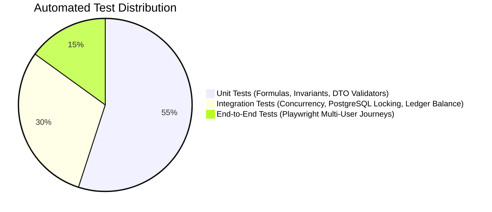

# EarnXpress — Quality Assurance & Comprehensive Test Plan

| Metadata | Details |
| :--- | :--- |
| **Document Version** | 1.1.0-AUDITED |
| **Project Code** | EX-QA |
| **Document Status** | Approved for Development Foundation |
| **Classification** | Master Test Specification |
| **Last Updated** | 2026-11-03 |
| **Test Stack** | Vitest / Jest (Unit), Supertest (Integration), Playwright (E2E) |

---

## 1. Testing Strategy for Open Marketplace & Multi-Worker Architecture



---

## 2. Critical High-Priority Integration Scenarios

### Scenario TC-INT-01: Multi-Worker Slot Stampede & Concurrency Protection
- **Objective**: Verify that when 50 concurrent workers attempt to claim the final remaining slot on a task, exactly 1 reservation succeeds and 49 receive `HTTP 409 Conflict`.
- **Method**:
  ```typescript
  test('TC-INT-01: Exactly one worker claims the final remaining slot under 50x parallel load', async () => {
    const task = await createTestTask({ totalSlots: 10, availableSlots: 1 });
    const workers = await create50TestWorkers();

    const responses = await Promise.all(
      workers.map(w => request(app.getHttpServer())
        .post(`/api/v1/tasks/${task.id}/accept-slot`)
        .set('Authorization', `Bearer ${w.token}`)
      )
    );

    const successes = responses.filter(r => r.status === 201);
    const conflicts = responses.filter(r => r.status === 409);

    expect(successes.length).toBe(1);
    expect(conflicts.length).toBe(49);

    const updatedTask = await prisma.task.findUnique({ where: { id: task.id } });
    expect(updatedTask.availableSlots).toBe(0);
  });
  ```

### Scenario TC-INT-02: Worker Participation Independence
- **Objective**: Verify that on a multi-worker task, Worker A's approval and payout has zero impact on Worker B's active work, and Worker C's rejection does not affect Worker A.
- **Assertion**:
  - Worker A status is `APPROVED` $\to$ demo earnings credited.
  - Worker B status remains `IN_PROGRESS` $\to$ deadline active.
  - Worker C status is `REJECTED` $\to$ 48h appeal window open.
  - Parent task status remains `OPEN` or `FULL`.

### Scenario TC-INT-03: `FIRST_APPROVED` Bounty Model Termination
- **Objective**: Verify that when a winning submission is approved in a `FIRST_APPROVED` task, all other active participations transition to `FIRST_APPROVED_CLOSED`.
- **Assertion**:
  - Winner status: `APPROVED` $\to$ receives 100% prize escrow.
  - Non-winning participations: `FIRST_APPROVED_CLOSED`.
  - Parent task status: `CLOSED`.

### Scenario TC-INT-04: 72-Hour `REVIEW_OVERDUE` Escalation (No Blind Auto-Approval)
- **Objective**: Verify that an unreviewed submission past 72 hours transitions to `REVIEW_OVERDUE` without automatically releasing demo funds.
- **Assertion**:
  - Submission status becomes `REVIEW_OVERDUE`.
  - Worker demo balance remains unchanged (funds stay in escrow).
  - Record appears in `/api/v1/admin/review-overdue`.
  - Upon Moderator executing `APPROVED_BY_STAFF`, funds are disbursed.

### Scenario TC-INT-05: Start Deadline Timeout
- **Objective**: Verify that a worker who accepts a slot but does not initiate activity before `start_deadline_hours` is timed out and the slot returns to the pool.
- **Assertion**:
  - Worker status becomes `TIMEOUT_START_EXPIRED`.
  - `tasks.available_slots` increments by 1.
  - Documented timeout reason recorded in audit log.

### Scenario TC-INT-06: Task Management Controls (Pause & Close Slots)
- **Objective**: Verify that a Buyer pausing a task blocks new workers from accepting, while active workers continue uninterrupted. Verify that closing remaining slots refunds unallocated demo escrow.
- **Assertion**:
  - After `PAUSE_TASK`, new slot acceptance returns `HTTP 400 Task is currently paused`.
  - Active workers can still submit deliverables.
  - After `CLOSE_REMAINING_SLOTS`, Buyer available demo balance increments by $\text{remaining\_slots} \times \text{unit\_escrow}$.

### Scenario TC-INT-07: Double-Entry Ledger Zero-Sum Verification
- **Objective**: Query PostgreSQL to verify that $\sum \text{Debits} = \sum \text{Credits}$ across all transactions in the `DemoLedgerEntry` table.
- **Assertion**: Zero rows returned with unbalanced debits and credits.

### Scenario TC-INT-08: Audit Log Immutability Protection
- **Objective**: Execute raw SQL `DELETE FROM "AuditLog"` or `UPDATE "AuditLog"`.
- **Assertion**: PostgreSQL raises an exception: `"Audit logs are immutable. UPDATE and DELETE operations are forbidden."`
