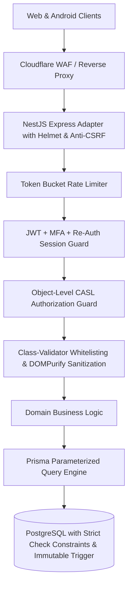

# EarnXpress — Comprehensive Security Architecture & Threat Model

| Metadata | Details |
| :--- | :--- |
| **Document Version** | 1.1.0-AUDITED |
| **Project Code** | EX-SEC |
| **Document Status** | Approved for Development Foundation |
| **Classification** | Master Security Specification |
| **Last Updated** | 2026-11-03 |
| **Standards Compliance** | OWASP ASVS Level 2, OWASP API Security Top 10 (2023) |

---

## 1. Threat Modeling & Defense-in-Depth Architecture



---

## 2. Authentication, Credential Security & Re-Authentication

### 2.1 Password Hashing Specification
- **Algorithm**: **Argon2id** (RFC 9106) configured with memory-hard parameters:
  - Memory cost: $65,536\text{ KB}$ ($64\text{ MB}$).
  - Time cost: $3$ iterations.
  - Parallelism: $4$ threads.
  - Salt length: 16 cryptographically random bytes.

### 2.2 Token Lifecycle & Session Rotation
- **Access Token**: Short-lived JWT signed with Ed25519/RS256. Expiry: **15 minutes**.
- **Refresh Token**: Opaque, 256-bit cryptographically secure string stored as a SHA-256 hash in PostgreSQL.
  - Transport: `HttpOnly`, `Secure`, `SameSite=Strict` cookie for Web; encrypted Android Keystore header for mobile.
  - Expiry: **7 days**.
  - Rotation: Rotated on every use. Presenting a reused token triggers an immediate breach alarm and revokes all active sessions for that user.

### 2.3 Re-Authentication for Sensitive Operations `[CONFIRMED]`
Users must re-enter their password or confirm a TOTP challenge when attempting sensitive actions:
1. Updating email address or password.
2. Generating or resetting MFA recovery codes.
3. Modifying payout addresses or banking reference data.
4. Elevating user roles (Platform Owner console).
5. Initiating platform fee or system configuration modifications.

---

## 3. Authorization & Privilege Escalation Defenses

### 3.1 Platform Owner Authority vs. Infrastructure Ownership
- **Application Authority**: The **Platform Owner** holds the highest application-level authority. Only the Owner can assign administrative roles (`SUPER_ADMIN`, `MODERATOR`, `SUPPORT_AGENT`) or modify system fee configurations.
- **Infrastructure Separation**: Application administrator accounts have zero access to cloud hosting panels, Linux root shells, or raw database superuser credentials. Server infrastructure is isolated behind dedicated SSH keychains and IAM role boundaries.

### 3.2 Broken Object-Level Authorization (BOLA / IDOR) Defenses
Every state-changing API request verifies ownership at the data access layer:
```typescript
async canAccessParticipation(user: CurrentUser, participationId: string): Promise<boolean> {
  const participation = await this.prisma.workerParticipation.findUnique({
    where: { id: participationId },
    include: { task: true }
  });
  if (!participation) throw new NotFoundException();

  const isWorker = participation.workerId === user.id;
  const isBuyer = participation.task.buyerId === user.id;
  const isStaff = [UserRole.PLATFORM_OWNER, UserRole.MODERATOR].includes(user.role);

  if (!isWorker && !isBuyer && !isStaff) {
    throw new ForbiddenException('Access denied to specified participation record');
  }
  return true;
}
```

---

## 4. Tamper-Evident Append-Only Audit Logging

### 4.1 Schema & Audit Invariants
Every sensitive administrative or financial event writes to `audit_logs`:
- `actorId`, `actorRole`, `action`, `resourceType`, `resourceId`, `previousState`, `newState`, `ipAddress`, `userAgent`, `reason`, `createdAt`.

### 4.2 Database Storage Engine Immutability
A PostgreSQL trigger unconditionally rejects `UPDATE` and `DELETE` queries on `audit_logs`:
```sql
CREATE OR REPLACE FUNCTION enforce_audit_immutability()
RETURNS TRIGGER AS $$
BEGIN
  RAISE EXCEPTION 'Audit logs are immutable. UPDATE and DELETE operations are forbidden.';
END;
$$ LANGUAGE plpgsql;

CREATE TRIGGER trg_audit_logs_immutable
BEFORE UPDATE OR DELETE ON "AuditLog"
FOR EACH ROW EXECUTE FUNCTION enforce_audit_immutability();
```

---

## 5. Web & API Security Defenses

- **SQL Injection**: 100% prevented via Prisma ORM parameterized queries. Raw SQL strings are prohibited.
- **Cross-Site Scripting (XSS)**: Automatic React JSX escaping. Markdown descriptions sanitized server-side via **DOMPurify** with a strict HTML whitelist (`<b>`, `<i>`, `<ul>`, `<ol>`, `<li>`, `<code>`, `<pre>`).
- **CSRF Protection**: Custom HTTP header `X-EarnXpress-Client` combined with `SameSite=Strict` session cookies.
- **Private Object Storage**: Evidence deliverables are uploaded directly to private S3 buckets using short-lived pre-signed `PUT` URLs (15m expiry). Downloads require short-lived pre-signed `GET` URLs (5m expiry).
- **Rate Limiting**:
  - Auth endpoints: 5 requests / min per IP.
  - Public search: 60 requests / min.
  - Standard API: 120 requests / min.
