# EarnXpress — Task Lifecycle & State Machine Specification

| Metadata | Details |
| :--- | :--- |
| **Document Version** | 1.1.0-AUDITED |
| **Project Code** | EX-LIFECYCLE |
| **Document Status** | Approved for Development Foundation |
| **Classification** | Master State Machine Specification |
| **Last Updated** | 2026-11-03 |

---

## 1. Dual-Layer Architecture: Task vs. Participation

To support high-capacity open marketplace operations, EarnXpress maintains an explicit separation between:
1. **Parent Task Campaign State Machine**: Manages marketplace discovery, slot availability, pause/close controls, and overall escrow allocation.
2. **Worker Participation State Machine (`WorkerParticipation`)**: Manages each individual worker's execution countdown, evidence submissions, review states, revision cycles, and simulated earnings settlement.

```mermaid
graph TD
    subgraph Parent Task Campaign Lifecycle
        T_DRAFT[DRAFT] --> T_PUB[PUBLISHED]
        T_PUB --> T_OPEN[OPEN: Available Slots > 0]
        T_OPEN <--> T_FULL[FULL: All Slots Claimed]
        T_OPEN <--> T_PAUSED[PAUSED: New Claims Frozen]
        T_FULL <--> T_PAUSED
        T_OPEN --> T_CLOSED[CLOSED: Slots Closed / Bounty Won]
        T_PAUSED --> T_CLOSED
        T_FULL --> T_CLOSED
        T_CLOSED --> T_COMPLETED[COMPLETED: All Work Settled]
        T_OPEN --> T_CANCELLED[CANCELLED: Task Terminated]
        T_PAUSED --> T_CANCELLED
    end

    subgraph Individual Worker Participation Lifecycle
        W_START[ACCEPTED / IN_PROGRESS] --> W_SUB[SUBMITTED]
        W_START --> W_ABAN[ABANDONED / TIMEOUT]
        W_SUB --> W_REV[UNDER_REVIEW]
        W_REV --> W_REVIS[REVISION_REQUESTED]
        W_REVIS --> W_SUB
        W_REV --> W_OVERDUE[REVIEW_OVERDUE: 72h Inactivity]
        W_REV --> W_APP[APPROVED: Settled]
        W_OVERDUE --> W_APP
        W_REV --> W_REJ[REJECTED]
        W_OVERDUE --> W_REJ
        W_REJ --> W_DISP[DISPUTED]
        W_DISP --> W_APP
        W_DISP --> W_REJ
        W_START --> W_CANC[CANCELLED: Task Cancelled]
    end
```

---

## 2. Parent Task State Machine Definitions

| Status | Definition & Invariants | Permitted Transitions |
| :--- | :--- | :--- |
| **`DRAFT`** | Task created in Buyer wizard. Unfunded; not visible on marketplace. | $\to$ `PUBLISHED`, `CANCELLED` |
| **`PUBLISHED`** | Demo escrow locked. Initializing slots for public discovery. | $\to$ `OPEN` |
| **`OPEN`** | Actively discoverable on marketplace. `available_slots > 0`. | $\to$ `FULL`, `PAUSED`, `CLOSED`, `CANCELLED` |
| **`FULL`** | All configured slots have been accepted (`available_slots == 0`). Hidden from open search. | $\to$ `OPEN` (if a worker times out), `PAUSED`, `CLOSED` |
| **`PAUSED`** | Buyer temporarily paused new slot acceptance. Active workers continue. | $\to$ `OPEN`, `CLOSED`, `CANCELLED` |
| **`CLOSED`** | Remaining unfilled slots permanently closed, or winning bounty approved in `FIRST_APPROVED`. Active workers finish. | $\to$ `COMPLETED` |
| **`CANCELLED`** | Task cancelled by Buyer or Staff. Unused escrow refunded. Active workers evaluated. | Terminal |
| **`COMPLETED`** | All accepted worker participations have reached terminal status (`APPROVED`, `REJECTED`, or settled). | Terminal |

---

## 3. Worker Participation State Machine Definitions

| Status | Definition & Invariants | Permitted Transitions |
| :--- | :--- | :--- |
| **`IN_PROGRESS`** | Worker accepted slot. Binding execution and start deadline countdowns active. | $\to$ `SUBMITTED`, `ABANDONED`, `CANCELLED` |
| **`SUBMITTED`** | Deliverables uploaded. Review SLA countdown begins (72 hours). | $\to$ `UNDER_REVIEW`, `REVIEW_OVERDUE` |
| **`UNDER_REVIEW`** | Buyer actively reviewing submission deliverables and criteria checklist. | $\to$ `APPROVED`, `REVISION_REQUESTED`, `REJECTED`, `REVIEW_OVERDUE` |
| **`REVISION_REQUESTED`**| Buyer cited unmet criteria; 48-hour worker revision countdown starts. | $\to$ `SUBMITTED`, `ABANDONED` |
| **`REVIEW_OVERDUE`** | 72 hours elapsed without Buyer review. Escalated to Staff review queue. | $\to$ `APPROVED` (Buyer or Staff), `REJECTED` (Staff), `DISPUTED` |
| **`APPROVED`** | Submission satisfies acceptance criteria. Demo earnings disbursed to Worker. | Terminal |
| **`REJECTED`** | Submission failed criteria. Worker granted 48h appeal window. | $\to$ `DISPUTED`, Terminal |
| **`DISPUTED`** | Escalated to Platform Moderator for binding arbitration. Escrow frozen. | $\to$ `APPROVED` (Worker Full / Split), `REJECTED` (Buyer Full) |
| **`ABANDONED`** | Worker missed start deadline or final execution deadline without submitting. | Terminal (Slot returned to pool if task open) |
| **`CANCELLED`** | Assignment cancelled due to parent task cancellation or mutual agreement. | Terminal |

---

## 4. Comprehensive Transition Matrix

Every transition requires an authorized actor, verified preconditions, timestamping, mandatory justification where applicable, and an immutable audit log event:

| Current Status | Event / Trigger | Authorized Actor | Preconditions | Target Status | Audit Event Code & Effect |
| :--- | :--- | :--- | :--- | :--- | :--- |
| `[None]` | Accept Task Slot | Worker | Task is `OPEN`, `available_slots > 0`, Worker has no active slot | `IN_PROGRESS` | `EVT_SLOT_ACCEPTED`: Atomic slot decrement; start deadline begins. |
| `IN_PROGRESS` | Submit Deliverables | Worker | Before deadline, deliverable files/notes attached, criteria attested | `SUBMITTED` | `EVT_DELIVERABLE_SUBMITTED`: 72h review timer starts. Files locked. |
| `IN_PROGRESS` | Missed Start / Exec Deadline | System Cron | Deadline timestamp elapsed without submission | `ABANDONED` | `EVT_WORKER_TIMEOUT`: Documented reason recorded; slot returned to pool if `OPEN`. |
| `SUBMITTED` | Open Submission | Buyer | Within 72h window | `UNDER_REVIEW` | `EVT_REVIEW_STARTED`: Audit timestamp recorded. |
| `UNDER_REVIEW` | Approve Submission | Buyer | Criteria confirmed met | `APPROVED` | `EVT_SUBMISSION_APPROVED`: Demo escrow disbursed to Worker (-4%). |
| `UNDER_REVIEW` | Request Revision | Buyer | Revisions remaining $> 0$, explicit criteria cited, $\ge 30$ chars feedback | `REVISION_REQUESTED`| `EVT_REVISION_REQUESTED`: Quota decremented; 48h revision SLA starts. |
| `REVISION_REQUESTED`| Submit Revision | Worker | Within 48h revision SLA | `SUBMITTED` | `EVT_REVISION_SUBMITTED`: New `SubmissionVersion` recorded; 72h timer resets. |
| `UNDER_REVIEW` | 72h SLA Elapsed | System Cron | 72h elapsed without Buyer action | `REVIEW_OVERDUE` | `EVT_REVIEW_OVERDUE`: Flagged to Moderator queue; 24h Buyer grace notice sent. |
| `REVIEW_OVERDUE` | Staff Review Approval | Moderator | Criteria satisfied by evidence | `APPROVED` | `EVT_STAFF_APPROVED`: Escrow disbursed; Buyer assessed inactivity flag. |
| `UNDER_REVIEW` | Reject Submission | Buyer | Explicit failed criteria cited with documented grounds | `REJECTED` | `EVT_SUBMISSION_REJECTED`: 48h dispute appeal window opened. |
| `REJECTED` | Appeal Rejection | Worker | Within 48h of rejection | `DISPUTED` | `EVT_DISPUTE_OPENED`: Escrow frozen; assigned to Moderator console. |
| `DISPUTED` | Arbitrate Dispute | Moderator | Evidence reviewed against active task instruction version | `APPROVED` / `REJECTED` | `EVT_DISPUTE_RESOLVED`: Binding ruling; demo ledger settled. |
| `OPEN` | Pause Task | Buyer / Admin | Task currently `OPEN` | `PAUSED` | `EVT_TASK_PAUSED`: New reservations blocked. Active work continues. |
| `OPEN` / `PAUSED` | Close Remaining Slots| Buyer | Unfilled slots $> 0$ | `CLOSED` | `EVT_SLOTS_CLOSED`: Unused demo escrow refunded; active work continues. |
| `OPEN` / `PAUSED` | Cancel Task | Buyer / Admin | Campaign active | `CANCELLED` | `EVT_TASK_CANCELLED`: Milestone evidence evaluated; active slots settled. |

---

## 5. Lifecycle Behavior by Task Model

### 5.1 `MULTI_WORKER` Task Model
- Each Worker proceeds through the participation state machine independently.
- The parent task transitions from `OPEN` to `FULL` when `available_slots == 0`. If an active worker abandons their slot, the slot is restored to `OPEN` (`available_slots = available_slots + 1`).
- The task transitions to `COMPLETED` only when **all** accepted worker participations have reached terminal status (`APPROVED`, `REJECTED`, or `DISPUTED`).

### 5.2 `FIRST_APPROVED` Bounty Model
- Multiple Workers may hold `IN_PROGRESS` and `SUBMITTED` participations simultaneously.
- When the Buyer or Staff approves the first submission that satisfies all acceptance criteria:
  1. The winning Worker's participation transitions to `APPROVED` and receives the full prize escrow.
  2. The parent task transitions immediately to `CLOSED`.
  3. All remaining active participations (`IN_PROGRESS` or `SUBMITTED`) transition gracefully to `FIRST_APPROVED_CLOSED`.
  4. Non-winning workers receive an automated notification and verified activity credit on their profile.
