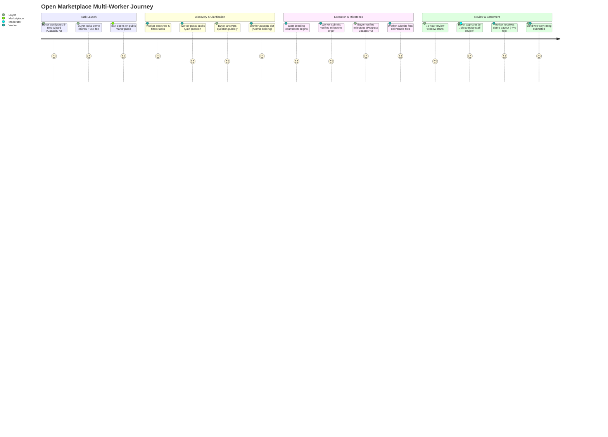
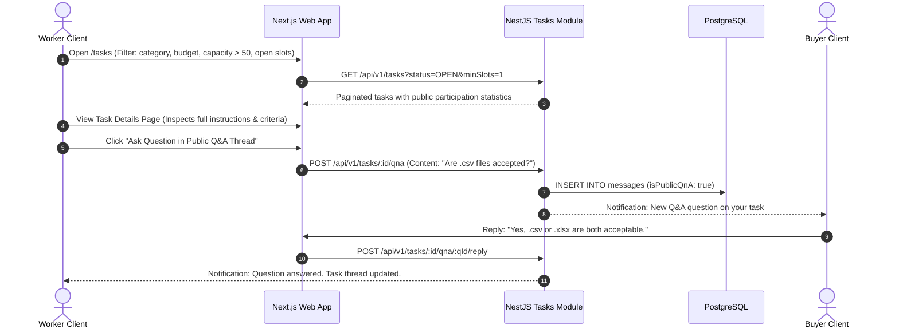
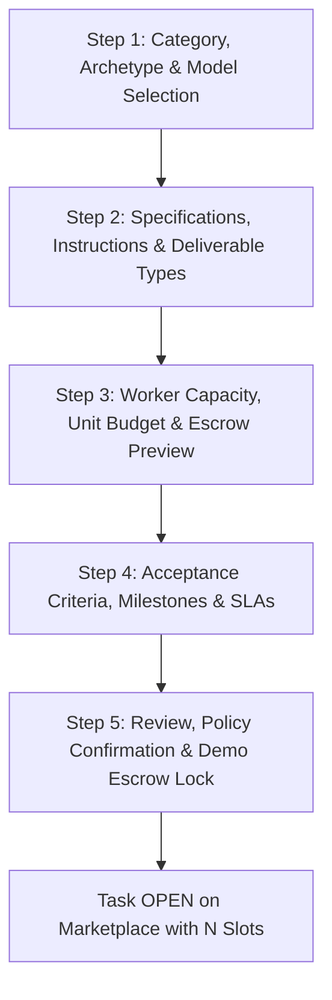
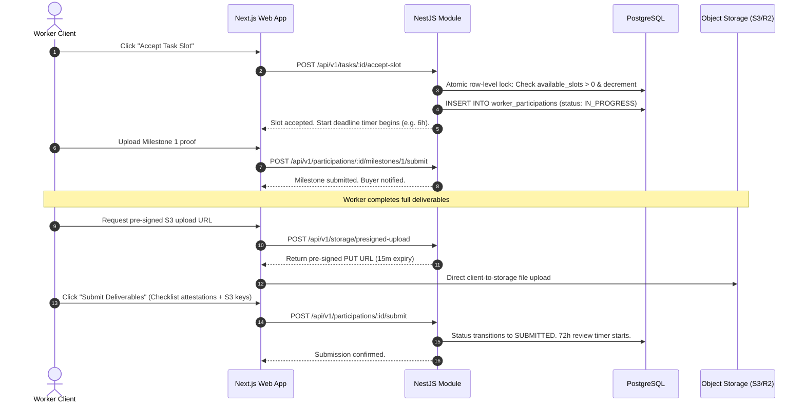

# EarnXpress — End-to-End User Flows

| Metadata | Details |
| :--- | :--- |
| **Document Version** | 1.1.0-AUDITED |
| **Project Code** | EX-FLOWS |
| **Document Status** | Approved for Development Foundation |
| **Classification** | Master User Journey Specification |
| **Last Updated** | 2026-11-03 |

---

## 1. Global User Journey: Open Marketplace Discovery to Settlement

---

## 2. Open Marketplace Discovery & Clarification Flow

---

## 3. Buyer Task Creation Wizard Flow (Configurable Capacity)

### Step 1: Category & Task Model Selection
- **Inputs**: Primary Category, Subcategory, Task Model (`MULTI_WORKER` or `FIRST_APPROVED`).

### Step 2: Task Instructions & Details
- **Inputs**: Task Title, Markdown Description, Required Skills, Deliverable Formats (Text, URL, File).

### Step 3: Capacity, Budget & Escrow Calculation
- **Inputs**: Configurable Worker Capacity ($N$, e.g., 50 slots), Unit Demo Budget per Slot ($B$, e.g., \$10.00).
- **Automated Breakdown**:
  - Gross Budget: $50 \times \$10.00 = \text{DEMO } \$500.00$
  - Buyer Platform Fee (2%): $\text{DEMO } \$10.00$
  - Total Demo Escrow Required: $\text{DEMO } \$510.00$
  - Insufficient Balance $\implies$ One-click **"Claim \$1,000 Demo Faucet Credit"** button.

### Step 4: Acceptance Criteria, Milestones & SLAs
- **Inputs**:
  - Minimum 2 discrete testable acceptance criteria items.
  - Optional Milestone Checkpoints (e.g. Milestone 1: Draft outline $\to 33\%$; Milestone 2: Final draft $\to 100\%$).
  - Start Deadline Hours (e.g. 6 hours to initiate activity).
  - Execution Duration Hours (e.g. 24 hours).
  - Maximum Allowed Revisions (default: 2).

### Step 5: Review & Atomic Demo Escrow Lock
- Displays comprehensive summary. Buyer confirms terms.
- System executes double-entry lock:
  - Debits `DEMO_BUYER_AVAILABLE` \$510.00.
  - Credits `DEMO_BUYER_ESCROW_RESERVED` \$510.00.
  - Task transitions to `OPEN` with 50 available slots.

---

## 4. Slot Acceptance, Milestones & Evidence Submission Flow

---

## 5. Review, `REVIEW_OVERDUE` & Escalation Flow

### 5.1 Buyer Approves Submission (Standard Path)
1. Buyer opens Task Participation Dashboard $\to$ Submissions Queue.
2. Selects Worker Submission. Reviews files, notes, and criteria attestations.
3. Clicks **"Approve Submission"**.
4. System executes atomic settlement:
   - Worker Net Demo Payout (96%): Credited to Worker's `DEMO_WORKER_AVAILABLE`.
   - Worker Commission (4%): Credited to `DEMO_SYSTEM_REVENUE`.
   - Buyer Surcharge (2%): Settled from `DEMO_BUYER_ESCROW_RESERVED` to `DEMO_SYSTEM_REVENUE`.
5. Slot status updates to `APPROVED`.
6. Buyer and Worker prompted for **Blind Two-Way Review**.

### 5.2 72-Hour Buyer Inactivity & Moderator Adjudication
1. Submission reaches Hour 72 without Buyer action.
2. Status updates to `REVIEW_OVERDUE`.
3. Automated critical notification sent to Buyer with final 24-hour response window.
4. Submission appears in the **Moderator Overdue Triage Console**.
5. At Hour 96: If Buyer remains inactive, an authorized Moderator audits the evidence against the objective criteria checklist.
   - **Criteria Met**: Moderator executes `APPROVED_BY_STAFF`. Funds released to Worker. Buyer assessed inactivity penalty.
   - **Criteria Unmet**: Moderator executes `REJECTED_BY_STAFF`. Escrow refunded to Buyer.
   - **Guaranteed Invariant**: Simulated earnings are never released without an explicit, valid settlement decision.
