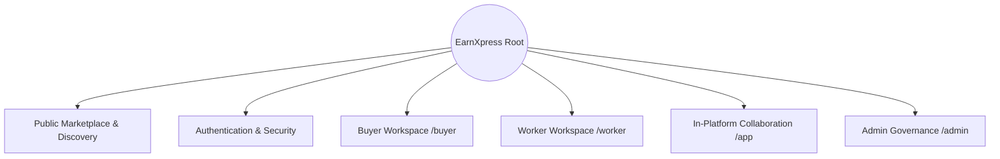

# EarnXpress — Website Sitemap & Information Architecture

| Metadata | Details |
| :--- | :--- |
| **Document Version** | 1.1.0-AUDITED |
| **Project Code** | EX-SITEMAP |
| **Document Status** | Approved for Development Foundation |
| **Classification** | Master Sitemap Specification |
| **Last Updated** | 2026-11-03 |
| **Target Framework** | Next.js App Router (`src/app/`) |

---

## 1. Information Architecture Overview

---

## 2. Public Marketplace Discovery

| Route Path | Page Title | Access Level | Description & Core Components |
| :--- | :--- | :--- | :--- |
| `/` | Open Marketplace Landing | Public | Featured tasks, capacity indicators, marketplace overview. |
| `/tasks` | Task Explorer & Catalog | Public | Faceted search (Category, Task Model, Budget, Capacity, Available Slots). |
| `/tasks/[id]` | Task Specification & Q&A | Public | Full instructions, acceptance criteria, **Task Participation Dashboard**, and public Q&A thread. |
| `/how-it-works` | Marketplace Mechanics | Public | Explains multi-worker participation, milestones, and dispute resolution. |
| `/pricing` | Commission Schedule | Public | Documents proposed 2% Buyer and 4% Worker fee structure. |
| `/trust-safety` | Verification & Governance | Public | Explains mock KYC demo, milestone verification, and staff arbitration. |

---

## 3. Authenticated Buyer Workspace (`/buyer`)

| Route Path | Page Title | Core Features & Actions |
| :--- | :--- | :--- |
| `/buyer/dashboard` | Buyer Command Center | Active campaigns, slot fill rates, pending submissions counter, demo balance summary. |
| `/buyer/tasks/new` | Task Creation Wizard | 5-step wizard (Model selection, Capacity, Budget, Criteria, Demo Escrow Lock). |
| `/buyer/tasks` | Campaign Directory | Filter by `OPEN`, `FULL`, `PAUSED`, `CLOSED`, `COMPLETED`. |
| `/buyer/tasks/[id]` | Campaign Analytics | Real-time slot breakdown, Pause Task, Close Remaining Slots, Cancel Task. |
| `/buyer/tasks/[id]/submissions`| Submissions Review Queue | Evidence viewer, Approve, Revision Request, Reject with grounds, Overdue alert. |
| `/buyer/tasks/[id]/qna` | Task Q&A Management | Answer public clarifying questions submitted by prospective workers. |
| `/buyer/demo-wallet` | Demo Financial Ledger | Available Demo Balance, Escrow Reserved, \$1,000 Faucet button, Transaction history. |

---

## 4. Authenticated Worker Workspace (`/worker`)

| Route Path | Page Title | Core Features & Actions |
| :--- | :--- | :--- |
| `/worker/dashboard` | Worker Workspace | Active assignments, start deadline timers, execution deadlines, demo earnings. |
| `/worker/tasks/active` | My Active Assignments | List of accepted tasks with live countdown timers and milestone progress bars. |
| `/worker/tasks/[id]/workspace`| Execution Workspace | Confidential instructions, resource downloads, milestone upload checkpoints. |
| `/worker/tasks/[id]/submit` | Deliverable Submission | Direct S3 upload, text notes, checklist completion attestations. |
| `/worker/demo-earnings` | Demo Earnings & History | Settled demo earnings, pending dispute amounts, simulated withdrawal history. |
| `/worker/verification` | Identity Verification Demo | Demonstration KYC interface, mock status tracker, appeal filing. |

---

## 5. In-Platform Collaboration & Disputes (`/app`)

| Route Path | Page Title | Core Features & Actions |
| :--- | :--- | :--- |
| `/app/messages` | Message Center | Private threaded messages between Buyer and Worker scoped to active task. |
| `/app/disputes` | Dispute Center | List of active and historical disputes involving user. |
| `/app/disputes/[id]` | Dispute Casefile | Immutable task requirements snapshot, evidence locker, moderator ruling. |
| `/app/reviews/[id]` | Blind Two-Way Review | Star ratings, sub-category ratings, public comment, blind 14-day reveal countdown. |
| `/app/settings/security` | Security & Re-Auth | Enable TOTP MFA, generate recovery codes, session invalidation. |

---

## 6. Administrative Governance Portal (`/admin`)

*Strictly accessible by authenticated staff with verified TOTP MFA session.*

| Route Path | Page Title | Access Control | Primary Capabilities |
| :--- | :--- | :--- | :--- |
| `/admin/dashboard` | Executive Overview | Staff | Global task capacity, active disputes, overdue review count, demo GMV. |
| `/admin/review-overdue` | Overdue Review Queue | Moderator / Owner | Submissions unreviewed past 72h; evidence inspection; binding staff approval/rejection. |
| `/admin/disputes` | Dispute Arbitration Queue| Moderator / Owner | Inspect immutable evidence, communication history, execute split demo settlements. |
| `/admin/tasks` | Task Moderation Queue | Moderator / Owner | Flag suspicious tasks, force cancellation, review reports. |
| `/admin/users` | User Directory | Staff | Search users, inspect participation history, issue warnings. |
| `/admin/users/[id]/sanction`| User Sanctions Engine | Moderator / Owner | Slot restrictions, suspensions, permanent bans with mandatory audit rationale. |
| `/admin/users/[id]/role` | Staff Role Assignment | **Owner Only** | Grant or revoke administrative roles (`SUPER_ADMIN`, `MODERATOR`). |
| `/admin/audit-logs` | Immutable Audit Explorer| Staff (Read-Only) | Filter append-only audit trail by actor, entity type, timestamp, IP. |
| `/admin/settings` | Platform Configuration | **Owner Only** | System fee config, global SLA timeouts, maintenance mode toggle. |

---

## 7. Android Native Application Parity Mapping

- Every route listed above has a direct 1:1 destination in the planned Android Jetpack Compose application.
- Deep-links supported across both platforms:
  - `earnxpress://tasks/{id}` $\to$ Task Details with Participation Dashboard.
  - `earnxpress://participations/{id}` $\to$ Worker Execution Workspace.
  - `earnxpress://disputes/{id}` $\to$ Dispute Casefile.
